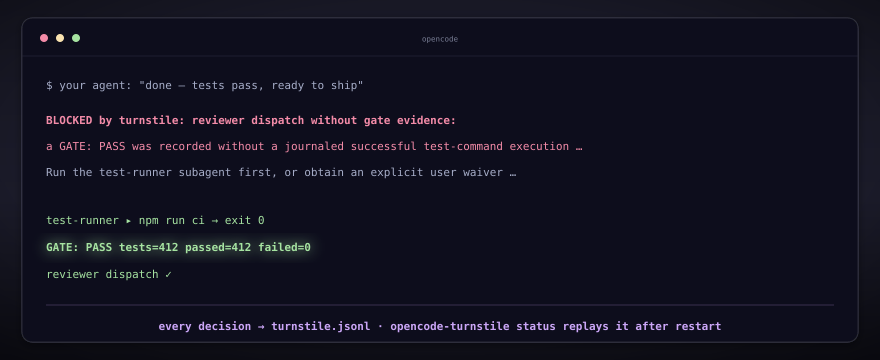

# turnstile

[](https://github.com/edseabolt/turnstile/actions/workflows/ci.yml)
[](https://www.npmjs.com/package/opencode-turnstile)
[](package.json)
[](package.json)
[](LICENSE)



**Verify what your agents claim.** An agent that says "tests pass" is asking
you to trust it. Turnstile checks instead: a reviewer dispatch stays blocked
until a `GATE: PASS` is correlated with a real exit-0 test run, an executor
stays blocked until a plan-reviewer has approved the plan, and every block,
verdict, and gate flip appends to an auditable JSONL journal —
`npx opencode-turnstile status` shows the evidence trail. Decided in tool and
task-dispatch hooks, outside the model loop. Zero runtime dependencies, fails
open.

## What you get

- **Premature dispatch blocked** — an executor cannot start against an
  unreviewed plan and a reviewer cannot start on an unverified test claim;
  blocked work says `BLOCKED by turnstile: <reason>`, never a silent
  violation.
- **Test claims verified** — a `GATE: PASS` greens the reviewer gate only
  when turnstile finds a journaled exit-0 test execution behind it; a bare
  claim stays unverified and the gate holds.
- **Plan approval journaled** — every verdict, waiver, block, and gate flip
  is appended to `turnstile.jsonl`; the evidence trail outlives the session
  and the replay window.
- **Restart-safe replay** — restart OpenCode mid-task and earned gate state
  comes back from the journal; the pipeline resumes where the evidence
  left it.

How it does it: an enforced pipeline — planner → plan-reviewer → executor →
test-runner → reviewer — with a gate at every hand-off, injected into your
session at runtime. Mechanics below the fold.

- Quick start: [below](#tldr--try-it-in-two-minutes)
- The walkthrough: [using it for real work](#using-it-for-real-work)
- How it works inside: [`docs/architecture.md`](docs/architecture.md)
- Day-to-day reference (waivers, config, journals, install modes):
  [`docs/usage.md`](docs/usage.md)

## TL;DR — try it in two minutes

```sh
npx opencode-turnstile init      # install the plugin + pipeline agents
npx opencode-turnstile check     # verify the install; must exit 0
```

Then **restart OpenCode** (or `opencode service restart`) so the plugin
loads. Prefer not to install the agent definitions? Add the plugin alone —
the gates still enforce, but the pipeline needs agents to dispatch against,
so run `init` (or bring your own, see
[`docs/usage.md`](docs/usage.md#customizing-the-pipeline-agents)):

```jsonc
// ~/.config/opencode/opencode.json
{ "plugins": ["opencode-turnstile"] }
```

After restart the orchestrator dispatches the pipeline on your prompts,
blocked work says `BLOCKED by turnstile: <reason>` instead of proceeding,
and every decision is journaled — see it with
`npx opencode-turnstile status`. To bypass the gates for a task, put
`USER WAIVER:` in **your own prompt**.

## Using it for real work

You never invoke the pipeline stages directly. Start a task the way you
already would, and the enforcement wraps it. The one habit to build: open
with the planner.


An [OpenCode](https://opencode.ai) v2 plugin that mechanically enforces an
agent pipeline: planner → plan-reviewer → executor → test-runner → reviewer.
The orchestrator policy is injected at runtime by the plugin (nothing is
written to any instructions file), and turnstile **blocks the dispatches
that violate it**.

**1. Start a task by invoking the planner.** Paste an issue or a topic into
your prompt and ask for a plan:

```text
Work on issue #42 (flaky retry in the upload path). Start from the planner:
produce a plan with a decomposition, then run the pipeline through review.
```

The orchestrator dispatches the planner, which writes a plan with numbered
`AC-n` / `chunk-N` entries to `.opencode/plans/`. From here the pipeline
drives itself — the `PIPELINE:` status line on each result names the next
stage:

```text
PIPELINE: planner=done plan=PENDING tests=RED reviewer=0/2
next=plan-reviewer — dispatch the next agent in this same turn
```

**2. The plan gate fires.** The plan-reviewer must record `VERDICT: APPROVE`
before any executor dispatch is allowed. A `VERDICT: BLOCK` sends the work
back to the planner — nothing for you to do unless you want to override:

```text
PLAN APPROVED: ship it as-is, the retry heuristic is good enough for now
```

(in your prompt — see [Waivers and approvals](#waivers-and-approvals)).

**3. The executor is gated on the approved plan** and must cite `chunk-N` /
`AC-n` entries from the decomposition, so implementation traces to the plan.

**4. Tests gate the reviewer.** The test-runner must emit
`GATE: PASS tests=…` and a matching exit-0 test execution must exist in the
task's history.

**5. The reviewer closes the loop.** Approval requires two unwaived
reviewer dispatches (ensemble); once credited, the landing gate releases
`git push`. Enforced landing (`gitGates.mode: "enforce"`) is the
recommended configuration and what this repo runs; the shipped default is
`shadow`, the adoption path where the same checks are journaled rather
than thrown.

When something fires early, you see the block, not a silent violation:

```text
BLOCKED by turnstile: executor dispatch requires an approved plan
(VERDICT: APPROVE from plan-reviewer, PLAN APPROVED: in your prompt,
or approve the permission ask)
```

Every block, verdict, and gate flip is appended to the journal —
`npx opencode-turnstile status` shows the state per session after the fact.

A full annotated session, with every dispatch, block message, waiver, and
the journal entries behind them, is in
[`docs/usage.md`](docs/usage.md#a-worked-session).

## What it enforces

Gates are decided in `execute.before` hooks; every gate has a human escape
hatch. Full detail (guards, state fields, escape ladders, diagrams) lives in
[`docs/architecture.md`](docs/architecture.md) (§5 Gate state machine).

| Gate                   | In one line                                                                                                                                                                                                                                                                                             |
| ---------------------- | ------------------------------------------------------------------------------------------------------------------------------------------------------------------------------------------------------------------------------------------------------------------------------------------------------- |
| Plan approval          | `executor` dispatches blocked while the plans dir holds a _pending_ plan — one lacking a current plan-reviewer `VERDICT: APPROVE` (or human approval) and a durable approved-plan record; plan edits invalidate the approval, and a durable record outlives the journal replay window and prompt resets |
| Reviewer dispatch gate | `reviewer` dispatches blocked until a `GATE: PASS` **verified** by a real exit-0 test execution in this task                                                                                                                                                                                            |
| Reviewer round cap     | Max 2 `reviewer` dispatches per task; waived dispatches bypass and don't count                                                                                                                                                                                                                          |
| Reviewer ensemble      | A reviewer APPROVE credits the landing gate only at ≥2 unwaived reviewer dispatches                                                                                                                                                                                                                     |
| Loop caps              | Per task: planner 3, plan-reviewer 3, test-runner 4, 16 total dispatches; exhaustion blocks and journals an `escalation` entry                                                                                                                                                                          |
| Decomposition gate     | `executor` dispatches must cite `chunk-N` / `AC-n` when a plan has a `## Decomposition` block                                                                                                                                                                                                           |
| Read horizon           | Warns at 8 whole-file `read` calls per session, blocks at 15 (prefer grep/glob)                                                                                                                                                                                                                         |
| Tool-call policy       | `bash`/`shell` commands and `write`/`edit` paths matched against a configured denylist (default empty; `enforce` mode)                                                                                                                                                                                  |
| Commit-lint            | `git commit -m` subjects must be conventional commits when `gitGates.commitMessages` is on (default)                                                                                                                                                                                                    |
| Landing gate           | `git push` without a credited reviewer `VERDICT: APPROVE` — blocks under the recommended `gitGates.mode: enforce` (this repo runs it), then escalates to the human ask; the shipped `shadow` default journals the would-block instead                                                                   |
| Marker parsing         | `GATE:` / `VERDICT:` markers parsed from task results and child text; only marker-contracted emitters flip state — echoes are journaled `suppressed`                                                                                                                                                    |
| Trace & telemetry      | JSONL journal of dispatches, gate transitions, verdicts, blocked calls, errors; `setup` heartbeat, stream-death errors                                                                                                                                                                                  |
| Decoding clamps        | reviewer/plan-reviewer temperature = 0; executor/test-runner/debugger ≤ 0.2                                                                                                                                                                                                                             |
| Compaction             | Injects a "preserve verbatim" instruction, then the live gate-state snapshot — de-tokenized so it can never re-parse as a marker                                                                                                                                                                        |

State lifecycle: a new user prompt resets the session's gate state. Replayed
gate state survives a restart and the next (resume) prompt, then reverts.

## Waivers and approvals

Turnstile reads a waiver or a human plan approval only from the user's OWN
prompt — the plugin observes it at prompt admission, never from an agent's
dispatch prompt. A marker inside an agent-composed prompt must never unlock
a gate, so the channel is checked, not the text.

- **`USER WAIVER:`** in your prompt waives gates. Naming configured agent
  stages (`planner`, `plan-reviewer`, `executor`, `test-runner`, `reviewer`)
  scopes it; unscoped covers every gate, but the reviewer gate consumes an
  unscoped waiver on the first dispatch it unlocks. A new prompt drops it.
- **`PLAN APPROVED:`** in your prompt approves the plan like a reviewer
  verdict, with human provenance; it replays across restart.
- **Permission escalation.** When no approval holds, the first executor
  dispatch escalates to you through OpenCode's permission surface — reply
  `always` (approved for the task), `once` (one dispatch), or `reject`.

Do not create, paste, or relay a `USER WAIVER:` / `PLAN APPROVED:` marker to
open a gate — only the user's own prompt carries a real waiver or approval.
Full lifecycle semantics (waiver allowances, ensemble interaction, prompt
channels): [`docs/usage.md`](docs/usage.md#waivers-and-approvals).

## Markers

Subagents must emit these as the first line of their output. These examples
are the canonical syntax; CI asserts the parser in `src/markers.ts` accepts
exactly them.

```
GATE: PASS tests=12 passed=11 failed=1
GATE: FAIL tests=12 passed=10 failed=2

VERDICT: APPROVE crit=0 high=0 med=2 low=1
VERDICT: BLOCK crit=1 high=0 med=0 low=2
```

Waiver and approval markers (must appear in the user's prompt, verbatim — a
dispatch prompt that merely contains the marker unlocks nothing):

```
USER WAIVER: <the user's words>
USER WAIVER: I approve proceeding to the <agent> stage
PLAN APPROVED: <the user's words>
```

## Install

Turnstile ships as the npm package
[`opencode-turnstile`](https://www.npmjs.com/package/opencode-turnstile).
Pick one way to install it; do not combine the plugin-array path with the
CLI install:

1. **Plugin only** — add `"plugins": ["opencode-turnstile"]` to
   `~/.config/opencode/opencode.json` and restart. Gates enforce; agent
   definitions are not installed.
2. **Full install** — `npx opencode-turnstile init` installs the plugin and
   the pipeline agent definitions into `~/.config/opencode`.
3. **From a clone** — clone the repo and run `npm run init` (symlink mode)
   so installed artifacts stay live against your edits.

Turnstile has no npm lifecycle hooks: installing the package never
writes to `~/.config/opencode` — that happens only when you run an explicit
command. Modes, conflicts, the ledger, upgrades, uninstall, and per-agent
model pins are covered in
[`docs/usage.md`](docs/usage.md#installing-and-maintaining).

Verify a clone with:

```sh
npm install
npm run ci            # lint, format:check, typecheck, check:markers, 100%-coverage test gate
npm run ci:installed  # install:check — run after `npm run init` on a machine with artifacts
```

## Configuration

Defaults live in code (`src/config.ts`); override via
`~/.config/opencode/turnstile.json`, environment variables, or both
(precedence: defaults < file < env; config is read once at setup — restart
sessions to apply). Copy
[`examples/turnstile.example.json`](examples/turnstile.example.json) as a
starting point: every key is optional and matches the code defaults. One
exception to know about: `agents.bareOutput` in the example is
`[]` because JSON cannot express the "unset" sentinel the code uses — an
explicit empty list disables the built-in derivation; delete the key to
inherit the default. The key
knobs most people touch:

| Key                          | Default            | Meaning                                                                                                                     |
| ---------------------------- | ------------------ | --------------------------------------------------------------------------------------------------------------------------- |
| `gitGates.mode`              | `shadow`           | recommend `enforce` (blocks commit-lint + unapproved pushes; this repo runs it); the `shadow` default journals would-blocks |
| `gateEvidence`               | `enforce`          | `flag`/`off` revert to flip-on-trust for `GATE: PASS`                                                                       |
| `reviewEnsemble`             | `enforce`          | `advise` credits a single-reviewer APPROVE unconditionally                                                                  |
| `toolPolicy.bashDeny`        | `[]`               | regex denylist for `bash`/`shell` (e.g. worktree/branch/merge ops)                                                          |
| `maxReviewerRounds` / others | 2 / 3 / 3 / 4 / 16 | per-leg and total dispatch caps per task                                                                                    |
| `agents.*`                   | stage names        | rename recognition when you bring your own agents                                                                           |
| `plansDir`                   | `.opencode/plans`  | where the decomposition scan looks                                                                                          |

Invalid keys are ignored, journaled, and summarized once into the session
context; a malformed config file never breaks the host. The full table —
every key, default, and environment variable (`TURNSTILE_TRACE`,
`TURNSTILE_METRICS_DIR`, `TURNSTILE_CONFIG`) — is in
[`docs/usage.md`](docs/usage.md#configuration); `schemas/turnstile.schema.json`
ships with the package for editor completion.

## What turnstile is not

Turnstile is a speed bump and an audit trail, not a security boundary. A
`GATE: PASS` is a claim correlated with evidence, not proof; the journal is
the record of what was _claimed_ and is treated as sensitive data (see
[SECURITY.md](SECURITY.md)); the denylist is a deterrent, not a sandbox; MCP
tools remain unguarded. The full threat model:
[`docs/architecture.md` §10](docs/architecture.md#10-security-posture-and-limits).

## Behavior contract

- Fail-open by design. Every hook body is guarded; internal errors are
  journaled and the tool call proceeds. The only thrown errors are the
  deliberate `BLOCKED by turnstile:` ones.
- The doc comment at the top of `turnstile.ts` is the authoritative summary
  of enforced contracts; this README mirrors it and CI keeps the marker
  examples in sync with the parser regexes.
- Host API is the OpenCode v2 promise-plugin shape
  (`{ tool.hook, session.hook, permission.hook, event.subscribe }` — the
  permission hook is registered when the host exposes it).

## More documentation

- [`docs/architecture.md`](docs/architecture.md) — how the plugin works
  inside: module map, hook surface, end-to-end task flow, gate state
  machine, journal/replay, policy injection, security posture, and
  ecosystem positioning, with rendered diagrams.
- [`docs/usage.md`](docs/usage.md) — day-to-day operation: a worked session,
  waivers and approvals in full, installing and maintaining (modes, ledger,
  model pins), the complete configuration table, journals and retention, and
  the `status` command.
- [SECURITY.md](SECURITY.md) — journal sensitivity and trust model.
