# turnstile

[](https://github.com/edseabolt/turnstile/actions/workflows/ci.yml)
[](https://www.npmjs.com/package/opencode-turnstile)
[](package.json)
[](package.json)
[](LICENSE)



An [OpenCode](https://opencode.ai) v2 plugin that mechanically enforces an
agent pipeline: planner → plan-reviewer → executor → test-runner → reviewer.
The pipeline policy is injected at runtime by the plugin (nothing is written
to any instructions file at install time), the policy steers the agents, and
turnstile **blocks the dispatches that violate it** — decided in tool and
task-dispatch hooks, outside the model loop.

The entry point is `turnstile.ts`; behavior lives in focused modules under
`src/` (one boundary per file). Zero runtime dependencies, fails open.

## Why turnstile — what OpenCode doesn't already do

OpenCode v2 gives you a strong native surface: subagents, per-tool
permissions, prompt instructions. Turnstile exists for the three things that
surface structurally cannot express:

1. **Stateful, task-scoped gates.** Permission rules are stateless
   per-tool-call decisions. No config can say "the executor is blocked until
   _this task's_ plan is approved" or "the reviewer dispatches at most twice
   _per task_." Turnstile keeps a gate state machine keyed off parent
   sessions, reset per prompt, decided in dispatch hooks.
2. **Evidence correlation.** A claimed `GATE: PASS` only flips a gate when a
   real exit-0 test execution exists in the task's tool history. Without
   that, a review gate is the model grading its own homework — a marker is
   plain text anyone can print.
3. **A decision journal.** Every gate transition, block, waiver, and
   dispatch is appended to a replayable JSONL journal, readable with
   `opencode-turnstile status` and restored across restarts. Host logs are
   diagnostics; this is an audit record of what was claimed and blocked.

The honest scope: turnstile is cooperative enforcement, not a security
boundary — it fails open and can be unloaded. Prompt discipline in
AGENTS.md gets you the _steering_ half of a pipeline; turnstile is the
_mechanical_ half — the part that still holds when the model doesn't.
Limits: [architecture §10](docs/architecture.md#10-security-posture-and-limits);
the full positioning: [architecture §11](docs/architecture.md#11-positioning-how-turnstile-fits-the-ecosystem).

For how the plugin works inside — module map, hook surface, gate state
machine, journal/replay, diagrams — see
[`docs/architecture.md`](docs/architecture.md).

## TL;DR — try it in two minutes

```sh
npx opencode-turnstile init      # install the plugin + pipeline agents
npx opencode-turnstile check     # verify the install; must exit 0
```

Then **restart OpenCode** (or `opencode service restart`) so the plugin
loads. Prefer not to install the agent definitions? Add the plugin alone:

```jsonc
// ~/.config/opencode/opencode.json
{ "plugins": ["opencode-turnstile"] }
```

Note: the plugin alone enforces the gates (recognition is by dispatch
_name_, not by installed files), but the orchestrated
planner → plan-reviewer → executor → test-runner → reviewer pipeline needs
the agent definitions to dispatch against — run `init` to get them, or
bring your own agents (see
[Customizing the pipeline agents](#customizing-the-pipeline-agents)).

What you'll see after restart:

- The orchestrator dispatches planner → plan-reviewer → executor →
  test-runner → reviewer; the executor won't dispatch until the plan is
  approved, the reviewer won't dispatch until tests are green, and `git push`
  waits for reviewer approval.
- Blocked work says `BLOCKED by turnstile: <reason>` instead of proceeding.
- Every decision is journaled to
  `~/.local/share/opencode/metrics/turnstile.jsonl`; see the readable state
  with `npx opencode-turnstile status`.
- Your escape hatch, always: put `USER WAIVER:` in **your own prompt** to
  bypass the gates for the task (see
  [Waivers and approvals](#waivers-and-approvals)).

### Let your agent install it

Paste this into any agent session:

```text
Install the turnstile plugin for my OpenCode (v2) setup:

1. Run: npx opencode-turnstile init
   - It installs the plugin and the pipeline agent definitions into
     ~/.config/opencode (plugin(s), agents). On a git checkout it links;
     otherwise it copies. Don't override the mode unless a step fails.
2. Run: npx opencode-turnstile check
   - It must exit 0. If it reports drift or a conflict, show me the output
     and stop — don't force anything with --force without asking me.
3. Do not edit any other files under ~/.config/opencode, and do not paste
   anything into AGENTS.md — turnstile injects its policy at runtime; there
   is no contract block.
4. Finish by telling me to restart OpenCode so the plugin loads, and print
   the three commands I can use to see gate state later:
   npx opencode-turnstile status [--json]
```

## What it enforces

Gates are decided in `execute.before` hooks; every gate has a human escape
hatch. Full detail — guards, state fields, escape ladders, diagrams — lives in
[`docs/architecture.md`](docs/architecture.md) (§5 Gate state machine).

| Gate                   | In one line                                                                                                                                                                                                                                                          |
| ---------------------- | -------------------------------------------------------------------------------------------------------------------------------------------------------------------------------------------------------------------------------------------------------------------- |
| Plan approval          | `executor` dispatches are blocked until the plan-reviewer records `VERDICT: APPROVE` (when a plan exists in `.opencode/plans/*.md`), or a human approves — `PLAN APPROVED:` in your prompt, a waiver, or a permission-prompt reply. Plan edits invalidate approvals. |
| Reviewer dispatch gate | `reviewer` dispatches are blocked until a test-runner `GATE: PASS` **verified** by a matching exit-0 test execution in this task (default `gateEvidence:enforce`), or a waiver.                                                                                      |
| Reviewer round cap     | Max 2 `reviewer` dispatches per task; waived dispatches bypass and don't count.                                                                                                                                                                                      |
| Reviewer ensemble      | Under `reviewEnsemble:enforce` (default), a reviewer APPROVE credits the landing gate only at ≥2 unwaived reviewer dispatches; otherwise it is refused and journaled, and the permission ladder decides.                                                             |
| Loop caps              | Per task: planner 3, plan-reviewer 3, test-runner 4, 16 total dispatches. Exhaustion blocks and journals an `escalation` entry — STOP, don't re-dispatch.                                                                                                            |
| Decomposition gate     | `executor` dispatches must cite `chunk-N` / `AC-n` when a plan has a `## Decomposition` block.                                                                                                                                                                       |
| Read horizon           | Warns at 8 whole-file `read` calls per session, blocks at 15 (prefer grep/glob).                                                                                                                                                                                     |
| Tool-call policy       | `bash`/`shell` commands and `write`/`edit` paths are matched against a denylist (default `enforce`); default denylist is git-protective (worktree, branch switch/checkout, merge, `gh pr`).                                                                          |
| Commit-lint            | `git commit -m` subjects must be conventional commits when `gitGates.commitMessages` is on (default); uninspectable forms (`-F`, `-t`, `--edit`) are blocked under `gitGates.mode:enforce`.                                                                          |
| Landing gate           | `git push` without reviewer `VERDICT: APPROVE` is blocked under `gitGates.mode:enforce` (default `shadow`); a repeat push escalates to a human ask — the repeat push is the decision point.                                                                          |
| Marker parsing         | `GATE:` / `VERDICT:` markers parsed from task results and child text, deduped per task; marker-less outputs from marker-contracted agents are journaled.                                                                                                             |
| Trace & telemetry      | JSONL journal of dispatches, gate transitions, verdicts, blocked calls, errors; `setup` heartbeat, stream-death errors.                                                                                                                                              |
| Decoding clamps        | reviewer/plan-reviewer temperature = 0; executor/test-runner/debugger ≤ 0.2.                                                                                                                                                                                         |
| Compaction             | Injects a "preserve verbatim" instruction for markers and findings.                                                                                                                                                                                                  |

State lifecycle: a new user prompt resets the session's gate state. Replayed
gate state survives a restart and the next (resume) prompt, then reverts —
every later prompt starts a clean cycle. `continuationCarry` (default off)
extends the carry to a prompt re-admitted in an unchanged worktree/branch;
because a new task on the same branch is indistinguishable from a
continuation, the carry is gate-scoped — it preserves earned state (an
already-earned `GATE: PASS` first), never an unearned approval.

## Waivers and approvals

Turnstile reads a waiver or a human plan approval only from the user's OWN
prompt — the plugin observes it at prompt admission, never from an agent's
dispatch prompt. The provenance rule is the point: a marker inside an
agent-composed prompt must never unlock a gate.

- **Prompt-channel waiver.** Put the literal marker `USER WAIVER:` in the text
  of your prompt to waive the plan gate and the reviewer gate for the task.
- **Prompt-channel approval.** Put `PLAN APPROVED:` in your prompt to approve
  the plan the same way a plan-reviewer `VERDICT: APPROVE` would; it records
  human provenance and replays across restart like a reviewer verdict.
- **Permission-prompt escalation.** When no approval holds, the first
  executor dispatch escalates to you through OpenCode's permission surface,
  naming the plan file and its head. Reply `always` (approved for the task),
  `once` (one dispatch), or `reject` (gate stays red).
- **How the plugin sees your prompt.** Capture happens at prompt admission on
  whichever host channel carries it — the `session` prompt hook, or the
  correlated `session.inbox.enqueued` admission (same message id, same
  marker, same journal shapes). A prompt delivered on neither channel is
  journaled as one distinguishing error rather than failing silently.

Do not create, paste, or relay a `USER WAIVER:` / `PLAN APPROVED:` marker to
open a gate — only the user's own prompt carries a real waiver or approval.

## Markers

Subagents must emit these as the first line of their output. These examples
are the canonical syntax; CI asserts the parser in `src/markers.ts` accepts
exactly them.

```
GATE: PASS tests=12 passed=11 failed=1
GATE: FAIL tests=12 passed=10 failed=2

VERDICT: APPROVE crit=0 high=0 med=2 low=1
VERDICT: BLOCK crit=1 high=0 med=0 low=2
```

Waiver and approval markers (must appear in the user's prompt, verbatim — a
dispatch prompt that merely contains the marker unlocks nothing):

```
USER WAIVER: <the user's words>
PLAN APPROVED: <the user's words>
```

## Install

Turnstile ships as the npm package
[`opencode-turnstile`](https://www.npmjs.com/package/opencode-turnstile).
There are three
ways to use it; pick one, and do not combine the plugin-array path with
the CLI install.

1. **Zero-config enforcement (plugin only).** Add the package to your
   OpenCode config's plugin array and restart. turnstile loads and enforces
   its gates, injecting the orchestrator policy into the primary session at
   runtime (see
   [Policy injection](docs/architecture.md#9-policy-injection)) — nothing is
   written to any instructions file, and the pipeline agent definitions are
   not installed by this option alone:

   ```json
   { "plugins": ["opencode-turnstile"] }
   ```

2. **Full install via the CLI.** `npx opencode-turnstile init` installs the
   plugin and the pipeline agent definitions; the orchestrator policy is
   injected at runtime by the plugin, so no contract block is written to
   `~/.config/opencode/AGENTS.md` (see
   [From a clone](#from-a-clone) below for the same commands run from
   a clone).

3. **Develop from a clone.** Clone this repo and run `npm run init`
   (symlink mode) so installed artifacts stay live against your edits.
   See [From a clone](#from-a-clone) below.

Verify the source with:

```sh
npm install
npm run ci          # ci:host (lint, format:check, typecheck, check:markers, test with a 100% coverage gate) — host chain only; green on a fresh clone
npm run ci:installed  # install:check — run after `npm run init` on a machine with installed artifacts
```

### No postinstall

Turnstile has **no** npm lifecycle hook (`postinstall`, etc.). Installing
`opencode-turnstile` as a dependency never writes to
`~/.config/opencode`; it only makes the gates available through the
plugin array. Everything else (the agent definitions) happens only when you
run an explicit command. This is deliberate: writes to your config directory
are opt-in, not automatic.

### Modes

`init` auto-detects an install mode: a git checkout installs by
linking (the working tree stays the source of truth, so edits are
live); an `npx` package install copies files (the installed files are
the source of truth). Override with `--link` or `--copy`:

```sh
npx opencode-turnstile init --copy
```

The chosen mode is recorded in the ledger, so `check` stays consistent
across reruns.

### Check

`npx opencode-turnstile check` verifies the installed state against the
manifest and exits 0 (clean) or 1 (drift). A copy install whose recorded
version is older than the published package is reported as a warning
(`check: outdated <dest> (installed X, package Y)`) and does not fail the
check.

### Upgrade

The plugin updates with your dependency manager (`npm upgrade
opencode-turnstile`, or your registry's equivalent). Re-run `check` to see
whether anything is outdated or drifted, then `init` to re-sync only what
changed: `npx opencode-turnstile init --copy` for package installs,
`npm run init -- --copy` from a clone. The injected orchestrator policy
travels with the plugin, so re-syncing the plugin re-supplies it — there is
no separate contract block to re-sync.

### Uninstall

`npx opencode-turnstile uninstall` reverses the install: it removes
ledger-owned copies and repo-owned symlinks and stops injecting the
orchestrator policy. It is idempotent and ownership-aware:
files it never installed (untracked files, symlinks pointing outside the
repo) are left alone, and a second run is a clean no-op. Injected policy is
gone the moment the plugin is unloaded; a legacy contract block once written
by hand into `~/.config/opencode/AGENTS.md` is not owned by turnstile and is
removed separately — see
[Policy injection](docs/architecture.md#9-policy-injection).

### From a clone

This repo is the source of truth for what lands in `~/.config/opencode`:
the plugin and the pipeline agent definitions are installed per the
manifest in `install.json`; unowned files in the target directories are
never touched. Two install modes are available:

|                           | Symlink (default)                                   | Copy (`--copy`)                                         |
| ------------------------- | --------------------------------------------------- | ------------------------------------------------------- |
| Best for                  | developing turnstile                                | general use, dotfiles repos that reject foreign links   |
| How targets point at repo | symlinks into the checkout                          | real copies                                             |
| After `git pull`          | nothing to do; edits are live on next session start | re-run `npm run init -- --copy` to re-sync              |
| Editing installed files   | edit the repo; links share it                       | edit the repo; user-edited copies conflict on next sync |

```sh
git clone <repo-url> && cd turnstile
npm install          # typescript + @types/node, for typechecking
npm run init      # symlink mode
# or: npm run install:copy
npm run install:check  # verify installed state; exit 1 on drift (gates local CI)
```

A target that differs from the repo is a **conflict**: `install` fails with
a per-path summary. Re-run with `--force` to back the file up
(`<name>.bak.<timestamp>`) and replace it. Conflicts mean:

- symlink mode: a real file (or a link pointing outside the repo) sits at a
  manifest target and differs from the source, typically pre-existing
  files or hand edits.
- copy mode: an installed copy was edited after install (the ledger can
  tell user edits from repo updates), or an untracked real file sits at a
  target.

Copy mode records everything it installed in
`~/.config/opencode/.turnstile-install.json` (the ledger: destination
mapped to source, content hash, package version, and install mode). The
ledger makes re-syncs safe: repo
updates re-copy cleanly and user edits fail loudly. It also lets the
installer remove copies whose manifest entry was deleted. Deleting the
ledger turns every copy into an untracked file the installer will refuse
to touch.

### Set the agents' models

The six agent definitions in `agents/` ship **without** a `model:`
frontmatter key. Each subagent therefore runs on the model of the session
that dispatched it — OpenCode v2's documented inheritance rule — so there
is nothing to configure for the common case.

To pin a specific model per agent, paste a block into
`~/.config/opencode/opencode.json` (**plural** `agents` is the v2 key;
v1 used singular `agent`):

```jsonc
{
  "$schema": "https://opencode.ai/config.json",
  "agents": {
    "planner": { "model": "anthropic/claude-haiku-4-5" },
    "plan-reviewer": { "model": "anthropic/claude-haiku-4-5" },
    "executor": { "model": "anthropic/claude-sonnet-4-5" },
    "test-runner": { "model": "anthropic/claude-haiku-4-5" },
    "reviewer": { "model": "anthropic/claude-sonnet-4-5" },
    "debugger": { "model": "anthropic/claude-sonnet-4-5" },
  },
}
```

Model IDs come from `opencode models` and take the form
`provider/modelID`, with an optional `#variant`. Restarts pick the change
up. Because the shipped definitions are silent on `model:`, a pin you add
is the only definition of that model — there is no merge precedence to
reason about.

Copy-mode users: after a `git pull` that changes these definitions,
re-run `npm run install:copy` to pick up the new frontmatter. `npm run
install:check` will report `stale` (not `conflict`) until you do.

### Printing a model config

To generate a `{"agents": {…}}` snippet instead of copying the six agent
names by hand, run the printer. It writes nothing — it short-circuits before
any install work, so the ledger, links, and copies are untouched:

```sh
npm run init -- --print-model-config
```

That prints one entry per agent, each defaulting to a placeholder:

```json
{
  "agents": {
    "planner": "<provider>/<model-id>",
    "plan-reviewer": "<provider>/<model-id>",
    "executor": "<provider>/<model-id>",
    "test-runner": "<provider>/<model-id>",
    "reviewer": "<provider>/<model-id>",
    "debugger": "<provider>/<model-id>"
  }
}
```

Seed individual agents with repeatable `--model` seeds. A bare
`provider/model` (optionally `#variant`) seeds all six; `name=` seeds one.
Model ids may be multi-segment — providers require interior slashes, e.g.
`oMLX/oQ/GLM-5.3-Flash-oQ4-mtp` — so the model body is everything after the
first slash.

```sh
npm run init -- --print-model-config \
  --model planner=anthropic/claude-haiku-4-5 \
  --model executor=oMLX/oQ/GLM-5.3-Flash-oQ4-mtp
```

Add `--validate` to cross-check every concrete seed against
`opencode models` and exit 1 naming a model it does not list; placeholder
seeds are skipped. `--model` and `--validate` are only valid with
`--print-model-config`: given without it, install.mjs prints an actionable
message and exits 2.

```sh
npm run init -- --print-model-config --model planner=anthropic/claude-haiku-4-5 --validate
```

Paste the output into `~/.config/opencode/opencode.json` (see the
[Set the agents' models](#set-the-agents-models) section).
`opencode-turnstile init -- --print-model-config` routes the same flags
through `scripts/install.mjs` and adds nothing of its own: `install.mjs`
recognizes `--print-model-config` and prints before writing, and the router
skips the agents install step entirely in that case — so the whole command
writes nothing (no ledger, no links, no agents, no injected policy). Plain
`init` still installs everything as usual.

### Customizing the pipeline agents

The agent definitions are opinionated on purpose: turnstile recognizes
and clamps them by name, and the marker contract in the agent prompts is
what the plugin enforces against. Editing the installed files is therefore
not a supported customization path: symlink installs share the repo file,
and copy installs conflict on the next sync.

Two sanctioned ways to change the pipeline:

- **Bring your own agents.** Add your own agent definitions (any names) to
  `~/.config/opencode/agents/`; the installer never touches files it does
  not own. Then point turnstile at them via
  `~/.config/opencode/turnstile.json`: `agents.planReviewer`,
  `agents.reviewer`, `agents.executor`, `agents.testRunner`, and
  `agents.debugger` take the names turnstile should recognize, clamp, and
  hold to the marker contract. Your agents get the same gates the shipped
  ones do.
- **Fork the repo.** To change the pipeline content itself, fork and edit
  `agents/*.md` there; your installer serves your fork.

One coupling to know when customizing either way: the shipped definitions
reference `.opencode/plans/` as turnstile's **default** `plansDir`, not a
constant — the plan path travels in the dispatch prompt, and the agents are
instructed to honor it over the default. If you reconfigure `plansDir`,
update your agent definitions' write permission (planner) accordingly; a
copy-mode user edits their installed copies, a fork edits `agents/*.md`.

### Updating

Symlink mode: because everything is linked into the checkout, updating is
just:

```sh
git pull            # in this repo
npm install         # only if dependencies changed
```

then restart OpenCode sessions (or `opencode service restart`) so the
running server reloads the plugin. There is no separate install step for
code or agent changes; the links are already live. Re-run
`npm run init` only when the **set** of artifacts changes (a new agent
added to `install.json`, an artifact removed or moved): it creates, fixes,
or removes repo-owned links to match the manifest.

Copy mode adds one extra step, because copies do not follow the repo:

```sh
git pull            # in this repo
npm install         # only if dependencies changed
npm run init -- --copy   # re-sync: re-copies changed files, skips clean ones
```

then restart OpenCode sessions. Unchanged files are skipped; changed ones
are re-copied; user-edited copies conflict and wait for `--force`.

Shared caveats:

- Symlinks point at the clone's absolute path. Do not move, rename, or
  delete the checkout; if you relocate it, re-run `npm run init`.
- `npm run install:check` reports drift between the manifest and what is
  actually installed. There is no `install:agents:check`: the orchestrator
  policy is injected from code (`src/policy.ts`), not a manifest-managed
  template, so nothing to verify there — `npm run ci:installed` is now just
  `install:check`. These install checks must run after `npm run init` on a
  machine with artifacts installed — a fresh clone has nothing to check. The
  host chain (`npm run ci` = `npm run ci:host`) covers lint, format:check,
  typecheck, check:markers, and test without the install checks. GitHub CI
  runs `npm run ci:host`, the host chain only, because a runner has no
  installs to check. Verify a copy install with
  `npm run install:check -- --copy`.

## Configuration

Defaults live in code (`src/config.ts`); override via
`~/.config/opencode/turnstile.json`, environment variables, or both.

**Quick start: copy the example config** — [`examples/turnstile.example.json`](examples/turnstile.example.json)
to `~/.config/opencode/turnstile.json` and edit from there. Every key in it
is optional and matches the code defaults; delete any key to fall back to the
default. One key is deliberately omitted from the example:

- `metricsDir`: computed at load time (`$XDG_DATA_HOME/opencode/metrics`,
  fallback `~/.local/share/opencode/metrics`); if you set it yourself it must
  be an absolute path (`~` is not expanded)

The example also carries `gateMarker` / `verdictMarker` verbatim so you can
see the format; leave them alone unless you are intentionally changing
the marker syntax (the shipped subagent definitions emit the canonical
markers).

Precedence: defaults < config file < env. The plugin reads config once, at
setup; restart sessions to apply. Invalid keys are ignored and journaled
(fail-open); a malformed config file never breaks the host.

| Key                                                                                                                        | Default                                                                            | Meaning                                                                                                                                                                                                                                |
| -------------------------------------------------------------------------------------------------------------------------- | ---------------------------------------------------------------------------------- | -------------------------------------------------------------------------------------------------------------------------------------------------------------------------------------------------------------------------------------- |
| `metricsDir`                                                                                                               | `$XDG_DATA_HOME/opencode/metrics`, fallback `~/.local/share/opencode/metrics`      | directory for both telemetry files                                                                                                                                                                                                     |
| `journalMaxBytes`                                                                                                          | 5242880                                                                            | rotate a journal file past this size                                                                                                                                                                                                   |
| `journalMaxGenerations`                                                                                                    | 5                                                                                  | rotated generations kept per journal                                                                                                                                                                                                   |
| `maxReviewerRounds`                                                                                                        | 2                                                                                  | reviewer dispatches per task, regardless of gate state (waived dispatches exempt)                                                                                                                                                      |
| `maxPlannerRounds`                                                                                                         | 3                                                                                  | planner dispatches per task (waived dispatches exempt)                                                                                                                                                                                 |
| `maxPlanReviewerRounds`                                                                                                    | 3                                                                                  | plan-reviewer dispatches per task (waived dispatches exempt)                                                                                                                                                                           |
| `maxTestRunnerRounds`                                                                                                      | 4                                                                                  | test-runner dispatches per task (waived dispatches exempt)                                                                                                                                                                             |
| `maxTotalDispatches`                                                                                                       | 16                                                                                 | total task dispatches per task across every leg — the global loop backstop (waived dispatches exempt)                                                                                                                                  |
| `maxSessions`                                                                                                              | 64                                                                                 | LRU cap on tracked sessions (gate state, child→parent edges, verdicts); registered live parents are never evicted                                                                                                                      |
| `readWarn` / `readBlock`                                                                                                   | 8 / 15                                                                             | whole-file read horizon                                                                                                                                                                                                                |
| `waiverMarker`                                                                                                             | `USER WAIVER:`                                                                     | literal waiver marker                                                                                                                                                                                                                  |
| `approvalMarker`                                                                                                           | `PLAN APPROVED:`                                                                   | literal prompt-channel plan-approval marker                                                                                                                                                                                            |
| `plansDir`                                                                                                                 | `.opencode/plans`                                                                  | executor decomposition scan directory                                                                                                                                                                                                  |
| `trace`                                                                                                                    | `true`                                                                             | write the human-readable trace file (JSONL journal always writes)                                                                                                                                                                      |
| `continuationCarry`                                                                                                        | `false`                                                                            | carry the task's gate flags across a prompt reset when the worktree/branch is unchanged (continuation), instead of starting a clean cycle                                                                                              |
| `agents.reviewer` / `agents.planReviewer` / `agents.executor` / `agents.testRunner` / `agents.debugger` / `agents.planner` | `reviewer` / `plan-reviewer` / `executor` / `test-runner` / `debugger` / `planner` | agent names recognized in dispatches                                                                                                                                                                                                   |
| `agents.bareOutput`                                                                                                        | `["test-runner", "reviewer", "plan-reviewer"]`                                     | agents whose marker-less output is a violation                                                                                                                                                                                         |
| `gateMarker` / `verdictMarker`                                                                                             | canonical regex sources                                                            | marker patterns, compiled with `gm`                                                                                                                                                                                                    |
| `gateEvidence`                                                                                                             | `enforce`                                                                          | `enforce` requires a correlating exit-0 test command to flip the gate; `flag` flips on trust (stamps `verified`); `off` journals without it                                                                                            |
| `reviewEnsemble`                                                                                                           | `enforce`                                                                          | `enforce` credits a reviewer `VERDICT: APPROVE` only when at least two unwaived `task -> reviewer` dispatches were journaled this task (`reviewerDispatches >= 2`); `advise` tracks and journals the count but credits unconditionally |
| `evidencePattern`                                                                                                          | a npm/pnpm/yarn/bun/deno/node `--test`/pytest/`make test`/go/cargo pattern         | regex matched (case-insensitively) against bash/shell commands; user-overridable for non-JS toolchains (e.g. Ruby/`rspec`)                                                                                                             |
| `toolPolicy.mode`                                                                                                          | `enforce`                                                                          | `enforce` blocks matching commands/paths; `shadow` journals would-blocks without throwing (adoption path); `off` is a silent no-op                                                                                                     |
| `toolPolicy.bashDeny`                                                                                                      | the git-protective defaults (worktree, branch switch/checkout, merge, `gh pr`)     | case-insensitive regex sources matched against `bash`/`shell` commands; an invalid source is dropped and journaled                                                                                                                     |
| `toolPolicy.pathDeny`                                                                                                      | `[]` (empty)                                                                       | case-insensitive regex sources matched against `write`/`edit` target paths; a dropped source is journaled                                                                                                                              |
| `toolPolicy.observeSessionMove`                                                                                            | `true`                                                                             | journal `session_move` dispatches as telemetry (never blocks)                                                                                                                                                                          |
| `gitGates.mode`                                                                                                            | `shadow`                                                                           | `shadow` would-block without throwing; `enforce` blocks invalid commits and unapproved pushes (opt-in), `off` is a silent no-op                                                                                                        |
| `gitGates.commitMessages`                                                                                                  | `true`                                                                             | validate `git commit -m` subjects as conventional commits; `shadow` journals, `enforce` blocks, `off` is a no-op                                                                                                                       |
| `gitGates.commitFormat`                                                                                                    | a conventional-commits regex source                                                | conventional-commits regex source (compiled `^...$`) matched against each subject; a bad source is dropped and journaled                                                                                                               |
| `gitGates.landingGate`                                                                                                     | `true`                                                                             | gate `git push` on this task reviewer `VERDICT: APPROVE`; `shadow` journals, `enforce` blocks then escalates, `off` is a no-op                                                                                                         |

Environment variables (override the file):

- `TURNSTILE_TRACE=0|1`: disable/enable the trace file
- `TURNSTILE_METRICS_DIR=<dir>`: relocate the telemetry directory
- `TURNSTILE_CONFIG=<path>`: use a different config file

## Files and journals

- Journals live outside the repo in `~/.local/share/opencode/metrics/`:
  - `turnstile.jsonl`: full JSONL trace; rotates at 5 MB, keeps 5
    generations
  - `gate-events.jsonl`: human-readable
    `YYYY-MM-DD HH:MM | agent | event | detail` lines, with an optional
    trailing ` | <sessionID>` segment when the trace line is wired to a
    session (the first four segments are unchanged when it is absent);
    suppressed entirely by `trace: false`
- Retention is bounded: 2 files × (1 current + 5 generations) × 5 MB ≈
  ~30 MB per journal, worst case ~60 MB total.
- `.opencode/plans/*.md` containing `## Decomposition` are load-bearing:
  their presence activates the executor chunk-citation gate.
- The journal also carries `{type:"ensemble", sessionID, agent, count}` entries:
  one per unwaived `task -> reviewer` dispatch, carrying the running `count`.
  Under `reviewEnsemble: enforce`, declining a single-reviewer APPROVE adds a
  `refusedApprove:true` stamp to the last `ensemble` entry and a
  `blocked` entry (`reason:"ensemble-incomplete"`, carrying `count` and
  `need: 2`). A human `always` release journals `refusedApprove:false` to clear
  the stamp. Each type is replayed at boot and contributes to the 2000-line
  tail: the last `ensemble` entry per session sets `reviewerDispatches`, and
  when it is stamped `refusedApprove:true` replay does not re-credit that
  APPROVE's `hasReviewApprove` on restart. When the landing gate is already
  released, a later APPROVE delivery is credited without a stamp: the release
  (human grant or mechanical) is never re-stamped as a refusal.

## Status

`opencode-turnstile status` reports turnstile gate and plan state per parent
session, read from the journal, as a human-readable table by default or JSON
with `--json`:

```
opencode-turnstile status
opencode-turnstile status --json
```

It is read-only: it never writes to the journal or config. Per session it
replays the same gate/plan last-wins rules the runtime uses (a trailing
`GATE: FAIL` keeps the gate red; an enforce-mode `verified:false` PASS never
flips), plus last markers, waiver events (with channel), and dispatch/block/
permission counts. Blocked dispatches are journaled with a `reason`
(`round-limit`, `loop-cap`, `dispatch-budget`, …) and every loop-cap exhaustion
additionally writes a paired `escalation` entry, so a stuck pipeline leaves a
visible trail in the journal. `turnstile status` does not yet parse or count
those new `loop-cap`, `dispatch-budget`, and `escalation` entries — that is a
documented gap, not a silence: the entries are written, they are just not
rendered by status yet. The journal reflects the last prompt-cycle; in-memory state
can be fresher (a session that has prompted since is newer than the journal
records), so treat status as the durable state of the previous cycle rather
than a live snapshot.

## What turnstile is not

Turnstile is a speed bump and an audit trail, not a security boundary.
The full threat model — evidence limits, journal trust, denylist gaps,
unguarded tool surfaces — lives in
[`docs/architecture.md` §10](docs/architecture.md#10-security-posture-and-limits).
The short version:

- A `GATE: PASS` without a correlated exit-0 test execution never flips the
  gate under the default `gateEvidence:enforce`; `flag`/`off` revert to
  flip-on-trust.
- The journal is the record of what was _claimed_, never proof — treat it as
  sensitive data (see SECURITY.md).
- The dispatch-prompt waiver-forgery vector is closed: waiver/approval
  markers work only in the user's own prompt.
- The denylist is a deterrent, not a sandbox; MCP tools remain unguarded.
- Use OpenCode's permission and sandboxing mechanisms against hostile agents.

## Behavior contract

- Fail-open by design. Every hook body is guarded; internal errors are
  journaled and the tool call proceeds. Removing the plugin leaves the
  pipeline functional (prompt contracts alone). The only thrown errors are
  the deliberate `BLOCKED by turnstile:` ones.
- The doc comment at the top of `turnstile.ts` is the authoritative summary
  of enforced contracts; this README mirrors it and CI keeps the marker
  examples in sync with the parser regexes.
- Host API is the OpenCode v2 promise-plugin shape
  (`{ tool.hook, session.hook, event.subscribe }`), verified against
  opencode v2.0.22.

## More documentation

- [`docs/architecture.md`](docs/architecture.md) — how the plugin works
  inside: module map, hook surface, end-to-end task flow, gate state
  machine, journal/replay, policy injection, security posture, and
  ecosystem positioning, with rendered diagrams.
- [SECURITY.md](SECURITY.md) — journal sensitivity and trust model.
