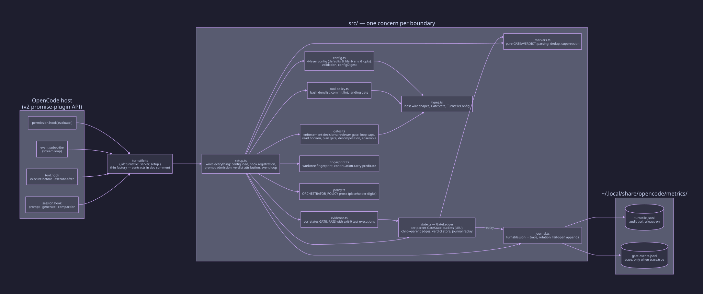
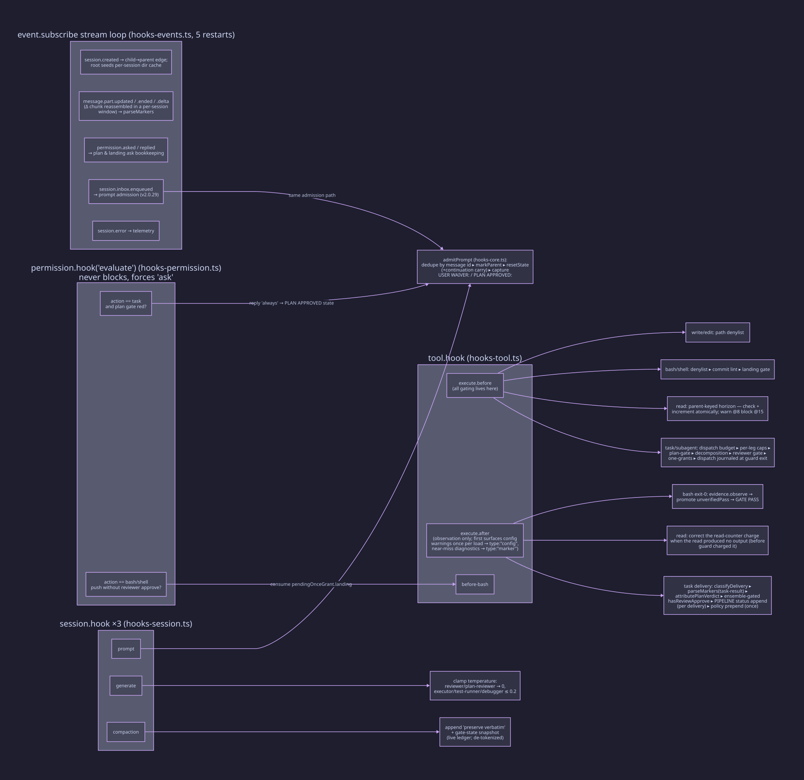
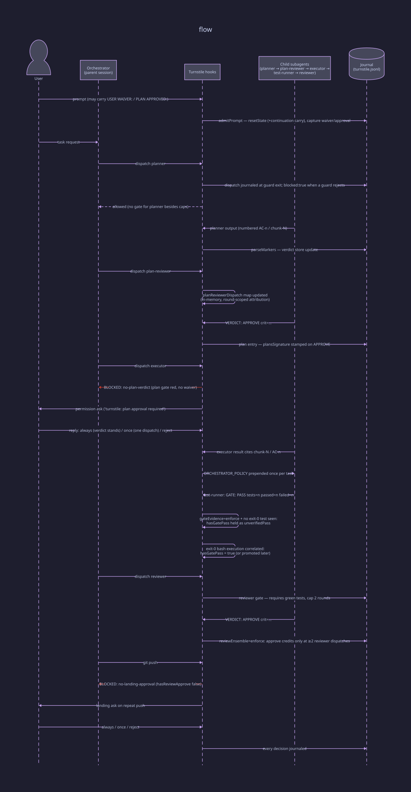
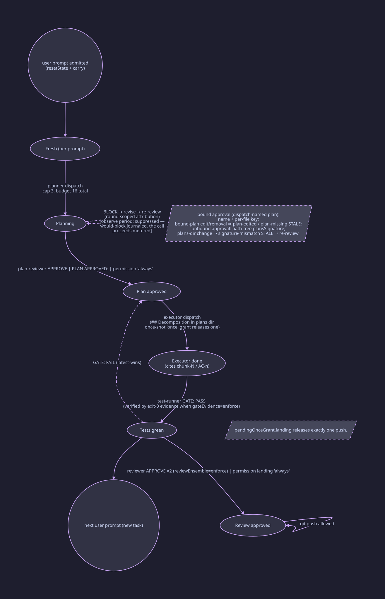
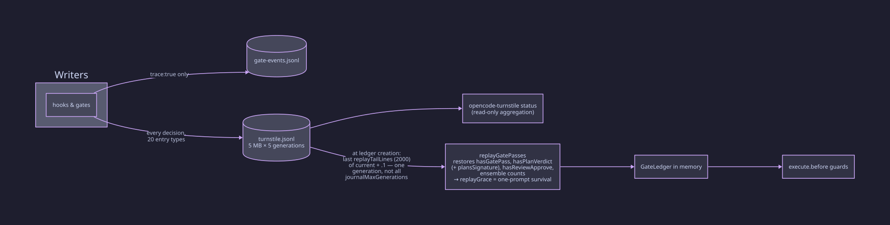

# Turnstile — Architecture

Turnstile is an OpenCode v2 promise-plugin that mechanically enforces an agent
pipeline (**planner → plan-reviewer → executor → test-runner → reviewer**) by
interposing on the host's hook surface: every dispatch, read, shell call, and
user prompt is checked against per-parent gate state before it is allowed to
proceed. Enforcement is fail-open — internal errors are journaled, never
thrown — except for deliberate `BLOCKED by turnstile:` errors.

This document is written for two audiences at once:

- **New users**: sections 1–4 explain what the plugin does to your sessions,
  which prompts unlock which gates, and where to look when a dispatch is
  blocked.
- **Developers**: sections 2, 5–8 map every module, hook, and state field to
  source. All claims carry function/hook names; `docs/diagrams/*.d2` are the
  editable sources for the SVGs in `docs/images/` (re-render with D2).

---

## Contents

1. [Overview](#1-overview)
2. [Module map](#2-module-map)
3. [Hooks: where the plugin intercepts the host](#3-hooks-where-the-plugin-intercepts-the-host)
4. [A task, end to end](#4-a-task-end-to-end)
5. [Gate state machine](#5-gate-state-machine)
6. [Persistence: journal and restart](#6-persistence-journal-and-restart)
7. [Configuration surface](#7-configuration-surface)
8. [Design invariants](#8-design-invariants)
9. [Policy injection](#9-policy-injection)
10. [Security posture and limits](#10-security-posture-and-limits)
11. [Positioning: how turnstile fits the ecosystem](#11-positioning-how-turnstile-fits-the-ecosystem)

---

## 1. Overview

Three ideas explain the whole plugin:

1. **A contract of markers.** Pipeline subagents emit machine-checkable first
   lines: the test-runner emits
   `GATE: PASS tests=<n> passed=<n> failed=<n>`; the reviewers emit
   `VERDICT: APPROVE|BLOCK crit=<n> high=<n> med=<n> low=<n>` (see
   `agents/test-runner.md`, `agents/reviewer.md`, `agents/plan-reviewer.md`).
   The planner emits no marker — instead it produces numbered `AC-n` /
   `chunk-N` entries that the executor must cite and the plan gate scans for
   (`## Decomposition` in `.opencode/plans/`).
2. **Per-parent gate state.** Every session that admits a user prompt becomes a
   _parent_ (`ledger.markParent`). Gate flags, round counters, and the read
   budget all key off the parent via the `childToParent` edge map — a
   subagent's reads and dispatches draw down its parent's budget, never its own.
3. **Fail-open plumbing, fail-toward-strict enforcement.** Hook bodies catch
   their own errors and journal them; only deliberate `BlockError` decisions
   reach the host. Where evidence can go stale (plan edits), the plugin
   invalidates approvals rather than trusting them.

Human decision points exist at every gate: a literal `USER WAIVER:`
(scope-aware — naming configured agent stages in the waiver text scopes it to
those stages' gates; an unscoped waiver covers every gate) or `PLAN APPROVED:`
in the **user's own prompt** (never in an agent-composed dispatch prompt), or
an interactive permission ask the plugin escalates when a gate is red.

---

## 2. Module map

One boundary per file under `src/`; dependencies flow one way, no cycles.
`turnstile.ts` stays a thin entry point (`{ id: "turnstile", server, setup }`;
`server` is a legacy v1 shim).



| Module                    | Responsibility                                                                                                                                                                                               |
| ------------------------- | ------------------------------------------------------------------------------------------------------------------------------------------------------------------------------------------------------------ |
| `turnstile.ts`            | Entry point: module shape + factory; the doc comment atop it is the authoritative contract summary                                                                                                           |
| `src/setup.ts`            | Wiring only: hook registration (per-surface hook modules below), the load heartbeat, lifecycle/disposal                                                                                                      |
| `src/hooks-core.ts`       | Shared hook state and services, built once per setup: `TurnstileContext` (config load, journaler, gates, ledger, admission, marker parsing, verdict attribution)                                             |
| `src/hooks-session.ts`    | Session-surface hook bodies: prompt admission, decoding clamps, compaction snapshot                                                                                                                          |
| `src/hooks-permission.ts` | Permission-surface hook body: plan-gate and landing-gate escalation (`evaluate`, forces `ask`)                                                                                                               |
| `src/hooks-tool.ts`       | Tool-surface hook bodies: all `execute.before` gating; `execute.after` observation (marker parsing, verdict attribution, policy head/tail, config/marker surfacing)                                          |
| `src/hooks-events.ts`     | Event-surface stream: child→parent edges, marker parsing from child text, permission ask/reply bookkeeping, inbox admission, bounded re-subscription                                                         |
| `src/delivery.ts`         | Host payload delivery: result-shape classification, text mutation (policy head/tail, config/marker blocks), candidate-key tables, ask-message prefixes                                                       |
| `src/config.ts`           | Four-layer config (code defaults ⊕ `~/.config/opencode/turnstile.json` ⊕ env ⊕ injected opts), per-key validation, `configDigest`                                                                            |
| `src/state.ts`            | Gate-state shape: fresh `GateState` bucket, metering-counter clearing, snapshot and pipeline rendering, replay-merge carry                                                                                   |
| `src/ledger.ts`           | `GateLedger`: per-parent `GateState` buckets (LRU), child→parent edges, child-verdict store, journal replay, live-parent eviction protection                                                                 |
| `src/markers.ts`          | Pure parsing of `GATE:`/`VERDICT:` regexes, dedup with first-sight provenance, cross-child suppression                                                                                                       |
| `src/gates.ts`            | Composition of the per-gate enforcement modules; the `Gates` interface is the host-facing contract                                                                                                           |
| `src/gates-dispatch.ts`   | Reviewer dispatch gate, loop caps, read horizon, ensemble completeness                                                                                                                                       |
| `src/gates-plan.ts`       | Plan-approval and decomposition gates, with the plans-dir scan and its cache                                                                                                                                 |
| `src/gates-common.ts`     | Shared `BlockError` and waiver coverage semantics                                                                                                                                                            |
| `src/tool-policy.ts`      | Stateless bash denylist, commit-message lint, landing-gate matching — throws the same `BlockError` as gates                                                                                                  |
| `src/evidence.ts`         | Correlates `GATE: PASS` against recorded exit-0 test executions per parent, with an optional task-window lower bound and a pure-read snapshot for refusal diagnostics                                        |
| `src/fingerprint.ts`      | Worktree fingerprint (git toplevel+branch) and the gate-scoped continuation-carry predicate                                                                                                                  |
| `src/journal.ts`          | Persistence: `turnstile.jsonl` audit trail + optional trace, append-only hot path with a periodic lock-guarded rename, fail-open appends                                                                     |
| `src/policy.ts`           | Orchestrator-policy prose built by `orchestratorPolicyFor` from the resolved config and injected into parent context once per task (template placeholders for digits so echoed text never parses as markers) |
| `src/types.ts`            | Host wire shapes, `GateState`, `TurnstileConfig`                                                                                                                                                             |

---

## 3. Hooks: where the plugin intercepts the host

`setup(h)` registers seven interception points, each tracked for disposal and
counted into the load heartbeat (`type:"setup"`). The hook bodies live in the
per-surface modules named below; `setup.ts` wires them and owns the lifecycle.



**`session.hook` ×3** (`hooks-session.ts`)

- **`prompt`** → `admitPrompt` (`hooks-core.ts`): the single prompt-admission body,
  shared with the inbox stream and deduped on the host message id. Marks the
  session a live parent, performs `resetState` (with optional
  continuation-carry via `fingerprint.ts` when the worktree is unchanged, and
  a release of the session's edge-registered children's metering counters —
  journaled `type:"child-reset"` when at least one is freed), clears evidence
  and latches, and captures `USER WAIVER:` / `PLAN APPROVED:`
  literals — a waiver capture also parses its scope, the configured agent
  names named in the waiver text (`parseWaiverScope` in `src/markers.ts`),
  into `userWaiverScope`. It also scans the text for marker-shaped near misses
  of the two literals (case, separator, or colon variants) — diagnostic-only:
  the strict
  literal capture is untouched, the hits are journaled `type:"marker"` and
  parked for one-shot surfacing.
- **`generate`** → decoding clamps: reviewer/plan-reviewer temperature forced
  to 0; executor/test-runner/debugger clamped ≤ 0.2.
- **`compaction`** → appends a system block demanding verbatim preservation of
  open findings, AC status, and the last GATE/VERDICT markers, then the live
  gate-state snapshot (`formatGateSnapshot`) from the ledger — concrete state,
  not just a demand. The snapshot's `GATE:`/`VERDICT:` tokens are de-tokenized
  (leading token lowercased) so it can never re-parse as an authoritative
  marker. It reads — never mints — the parent bucket via `ledger.peek`,
  keyed off `draft.sessionID` and falling back to the last-admitted parent
  whenever parent resolution yields no bucket; both paths degrade to
  instruction-only (fail-open, no mint, no journal spam).

**`tool.hook("execute.before")`** (`hooks-tool.ts`) — _all gating lives here_:

- `task`/`subagent`: dispatch budget (16 total), per-leg caps
  (planner 3 / plan-reviewer 3 / test-runner 4), plan-approval gate,
  decomposition gate, reviewer gate (green tests + round cap 2), one-shot
  grants.
- `read`: parent-keyed read horizon — warn at 8 whole-file reads (once per task), block at 15.
- `bash`/`shell`: bash denylist → commit-message lint → landing gate
  (`git push` requires reviewer approval).
- `write`/`edit`: path denylist.

**`tool.hook("execute.after")`** (`hooks-tool.ts`) — observation only, never blocks: first surfaces any
config-validation warnings once per load (a `[turnstile] config:` block
prepended to the first string-output result, journaled `type:"config"`), then
surfaces pending near-miss marker diagnostics once per prompt batch (a
`[turnstile] marker:` block prepended to the first string-output result of a
parent with a parked hit, journaled `type:"marker"` / `surfaced`), then
parses markers out of task deliveries, attributes plan verdicts, credits reviewer
approval (ensemble-gated), appends the per-delivery `PIPELINE:` status tail
(skipped when the delivery's agent is not a pipeline stage), prepends the
orchestrator policy head once per task (the first pipeline delivery reads
head+tail, later deliveries tail-only),
corrects the read counter charge down when a read produced no string output
(`execute.before` charged it on the guard), and promotes an `unverifiedPass`
when a correlated exit-0 test execution appears — the same correlation
re-checks when a child→parent edge resolves late (a background dispatch, via
`session.created` or `session.get`) and again at reviewer-dispatch time,
bounded to the parent's current task window (stamped at prompt admission).

**`permission.hook("evaluate")`** (`hooks-permission.ts`) — never blocks; when the plan gate is red on
a task dispatch, or a push lacks reviewer approval, it _forces_ an interactive
`ask` to the user. Replies are matched to recorded ask request-IDs only:
`always` stands a verdict/approval, `once` releases exactly one dispatch/push,
`reject` keeps the gate red.

**`event.subscribe` loop** (`hooks-events.ts`) — child→parent edges (`session.created`), marker
parsing from streamed child text (`message.part.updated`,
`session.text.ended`, `session.text.delta`): each `GATE:`/`VERDICT:`
observation is applied only when the emitting session's agent holds the marker
contract for that kind (a `GATE:` from `test-runner`, a `VERDICT:` from
`reviewer` / `plan-reviewer`), and a denied observation is journaled
`suppressed` rather than flipping state, permission ask/reply bookkeeping,
prompt admission via `session.inbox.enqueued` (opencode ≥ 2.0.29 — an
additive channel the host publishes immediately after the prompt hook fires,
deduped against the hook path on the shared host message id), and error
telemetry. Streamed child text
is ingested through a per-session sliding window: a marker the host splits
across `session.text.delta` chunks is reassembled and re-parsed so a completed
marker is first-sighted once (dedup-suppressing the re-parse), then the window
ages out on the next task dispatch. A subscription that throws or a stream that
completes without abort is journaled and the consumer re-subscribes up to a
cumulative budget of 5 restarts; the terminal disablement journals and
`session.text.*` ingestion stops once the budget is spent (a throw while
aborted stays silent).

---

## 4. A task, end to end

The three lifelines: orchestrator (parent session), child subagent sessions,
and the journal — the only persistence edge.



A typical enforced run:

1. The user's prompt is admitted; a new task resets prior gate state (or
   carries earned flags across a continuation prompt with an unchanged
   worktree fingerprint).
2. The planner runs (subject only to loop caps); its `AC-n`/`chunk-N` plan
   lands in `.opencode/plans/`.
3. The plan-reviewer must APPROVE. A BLOCK dead-ends nothing: the plan is
   revised and re-review is attributed via round-scoped evidence (the newest
   dispatched plan-reviewer round wins within the parent).
4. The executor is gated on plan approval; its result must cite `chunk-N` /
   `AC-n` entries from the decomposition.
5. The test-runner's `GATE: PASS` may require corroborating exit-0 bash
   evidence (`gateEvidence:"enforce"`); without it the flag is held as
   `unverifiedPass` and promoted when evidence arrives — including when a
   late child→parent edge back-fills the correlation, and only for
   executions journaled within the parent's current task window.
6. The reviewer's APPROVE credits the landing gate — under
   `reviewEnsemble:"enforce"` only after ≥2 unwaived reviewer dispatches.
7. `git push` is blocked until reviewer approval exists; a repeat push arms the
   interactive landing ask.

---

## 5. Gate state machine

All state is keyed per parent session. `replayGrace` gives restart-restored
flags a one-prompt survival window; `continuationCarry` re-arms it when a
continuing prompt has an unchanged worktree fingerprint.



### What each gate blocks

| Gate               | Guard                                            | Blocks                                                                                                                                                                                                                                                                      | Escape hatches                                                                                                                                                             |
| ------------------ | ------------------------------------------------ | --------------------------------------------------------------------------------------------------------------------------------------------------------------------------------------------------------------------------------------------------------------------------- | -------------------------------------------------------------------------------------------------------------------------------------------------------------------------- |
| Reviewer dispatch  | `guardReviewerDispatch`                          | reviewer task until `hasGatePass`; round cap 2 (a scoped waiver spends its own allowance: max 2 waiver-unblocked dispatches on `reviewWaiverRounds`, metered apart from `reviewRounds`)                                                                                     | `userWaiver` covering `reviewer` (unscoped covers every stage)                                                                                                             |
| Plan approval      | `enforcePlanApproval`                            | executor task until `hasPlanVerdict` is current: a bound approval (dispatch-named plan) is stale only on that plan's edit/removal (`plan-edited` / `plan-missing`); unbound approvals go stale on any plans-dir change (`signature-mismatch`; a same-content move survives) | `userWaiver` covering `plan-reviewer` or `executor` (the plan-gate stage group; unscoped covers every stage), `PLAN APPROVED:`, permission `always`, one-shot `once` grant |
| Decomposition      | `enforceDecomposition`                           | executor task without a chunk cite when the resolved plan (dispatch-named → session-bound → first sorted decomposed) carries `## Decomposition`                                                                                                                             | —                                                                                                                                                                          |
| Loop caps / budget | `guardDispatchBudget`                            | planner>3, plan-reviewer>3, test-runner>4, total>16 — a block on an edge-registered child carries the end-the-turn-and-report clause (it never admits a user prompt) and stamps `parent` on the entries                                                                     | `userWaiver` covering the dispatched stage (unscoped covers every stage); the parent's next prompt (releases the registered children's counters)                           |
| Read horizon       | `guardReadLimit`                                 | whole-file read #15+ per parent (warn once at 8)                                                                                                                                                                                                                            | —                                                                                                                                                                          |
| Reviewer ensemble  | `reviewEnsembleComplete`                         | landing credit below 2 unwaived reviewer dispatches                                                                                                                                                                                                                         | `reviewEnsemble:"advise"`                                                                                                                                                  |
| Landing            | `guardLanding`                                   | `git push` without `hasReviewApprove`                                                                                                                                                                                                                                       | permission `always` / `once`                                                                                                                                               |
| Tool policy        | `guardBash` / `guardCommitMessage` / `guardPath` | denied git operations (worktree, branch switch, merge, `gh pr`), non-conforming commit subjects (`enforce` mode)                                                                                                                                                            | mode `shadow` / `off`                                                                                                                                                      |

### Key `GateState` fields (`src/types.ts`)

| Field                                                                                        | Set by                                                                                                                                     | Cleared by                                                                                                               | Blocks                                                                                                                     |
| -------------------------------------------------------------------------------------------- | ------------------------------------------------------------------------------------------------------------------------------------------ | ------------------------------------------------------------------------------------------------------------------------ | -------------------------------------------------------------------------------------------------------------------------- |
| `hasGatePass`                                                                                | first-sight `GATE: PASS`; evidence promotion; replay                                                                                       | `GATE: FAIL` (latest-wins); prompt reset                                                                                 | reviewer dispatch                                                                                                          |
| `unverifiedPass`                                                                             | `GATE: PASS` without correlated exit-0 test (`gateEvidence:"enforce"`)                                                                     | green flip; FAIL; task reset                                                                                             | reviewer block reason becomes `gate-unverified`                                                                            |
| `hasPlanVerdict`                                                                             | plan-reviewer APPROVE; `PLAN APPROVED:`; permission `always`; replay                                                                       | BLOCK; signature mismatch; prompt reset                                                                                  | executor dispatch                                                                                                          |
| `plansSignature`                                                                             | stamped at approval from the path-free plans-dir signature; replayed from the `plansSig` journal field; governs **unbound** approvals only | BLOCK; (unbound) plans-dir change ⇒ `signature-mismatch` STALE journaled + re-review                                     | stale unbound approvals                                                                                                    |
| `approvedPlan` / `approvedPlanKey`                                                           | stamped at approval when the dispatch prompt names exactly one existing plan file (replayed from the `plan`/`planKey` journal fields)      | BLOCK; the bound plan's edit ⇒ `plan-edited` STALE; its removal ⇒ `plan-missing` STALE; prompt reset                     | stale bound approvals (per-plan staleness)                                                                                 |
| `hasReviewApprove`                                                                           | reviewer APPROVE on task-result delivery, ensemble-gated; landing permission `always`; replay                                              | prompt reset                                                                                                             | `git push`                                                                                                                 |
| `userWaiver`                                                                                 | `USER WAIVER:` in the user's prompt only (trace-gated quote, or `<present>` when `trace` is off)                                           | unscoped: the first reviewer dispatch it unlocks; prompt reset (never carried through `mergeAfterReplay`)                | every gate while unscoped; the named stages' gates when scoped (the plan gate is covered by `plan-reviewer` or `executor`) |
| `userWaiverScope`                                                                            | parsed at capture from the waiver text — the configured agent names named in it (`parseWaiverScope`, `src/markers.ts`); `[]` = unscoped    | prompt reset (never carried through `mergeAfterReplay`)                                                                  | none — scopes `userWaiver` to the named stages' gates (a name with no guarded gate scopes it to nothing)                   |
| `userWaiverConsumed`                                                                         | the reviewer gate consuming an unscoped waiver                                                                                             | prompt reset (never carried through `mergeAfterReplay`)                                                                  | none — reports the consumed state to block messages and the compaction snapshot                                            |
| `reviewWaiverRounds`                                                                         | scoped-waived reviewer dispatches (one allowance slot each)                                                                                | prompt reset (never carried through `mergeAfterReplay`; deliberately not shared with the replay-restored `reviewRounds`) | reviewer dispatch past the waiver allowance (`maxReviewerRounds` waiver-unblocked dispatches)                              |
| `pendingOnceGrant.plan/.landing`                                                             | permission reply `once`                                                                                                                    | consumed by one executor dispatch / one push                                                                             | per-reason keying prevents cross-consumption                                                                               |
| `reviewRounds`, `plannerRounds`, `planReviewerRounds`, `testRunnerRounds`, `totalDispatches` | dispatch guards                                                                                                                            | prompt reset                                                                                                             | round caps / budget                                                                                                        |
| `reads`                                                                                      | `execute.before` increments; `execute.after` corrects a failed read                                                                        | prompt reset                                                                                                             | warn once at 8 / block 15                                                                                                  |
| `readWarned`                                                                                 | first string-output read at-or-past `readWarn`                                                                                             | prompt reset                                                                                                             | read-budget warn injection (once per task)                                                                                 |
| `replayGrace`                                                                                | journal replay; continuation-carry re-arm                                                                                                  | consumed by first `resetState`                                                                                           | one-prompt survival of restored flags                                                                                      |
| `taskFingerprint`                                                                            | stamped when `continuationCarry` on                                                                                                        | new stamp                                                                                                                | identity signal for carry                                                                                                  |
| `lastGateMarker`, `lastVerdictMarker`                                                        | stamped at first-sight `GATE:`/`VERDICT:` (de-tokenized, so they cannot re-parse)                                                          | prompt reset                                                                                                             | rendered into the compaction snapshot; display only, never enforces                                                        |

---

## 6. Persistence: journal and restart



The journal lives outside the repo at `~/.local/share/opencode/metrics/`:

- **`turnstile.jsonl`** — the always-on audit trail (20 entry types:
  `setup`, `dispatch`, `gate`, `plan`, `verdict`, `ensemble`, `blocked`,
  `escalation`, `permission`, `attribution`, `policy`, `config`, `marker`,
  `continuation`, `child-reset`, `evidence`, `violation`, `tool`, `error`,
  `suppressed`). A `dispatch` entry is written at
  guard exit and stamps `blocked:true` when a guard rejected the attempt (the
  guard's own `blocked` entry is the countable signal; `scripts/status.mjs`
  excludes the stamp from its dispatches counter to avoid a double count).
  A `suppressed` entry is the audit trail for a `GATE:`/`VERDICT:` marker first
  observed from an unauthoritative emitter — an agent without the marker
  contract for that kind (`GATE:`↔`test-runner`, `VERDICT:`↔`reviewer` /
  `plan-reviewer`), or one whose agent could not be resolved. It is
  audit-only and replay-inert (nothing replays against a denial), its marker
  string carries the digits for forensics, and a re-delivery of identical text
  adds none (dedup stays registered). Both journal replay and the status
  aggregate treat it as inert.
  A `config` entry is the surface audit for the once-per-load `[turnstile]
 config:` block: `{type:"config", sessionID, surfaced:true, count}` on a
  successful prepend, or `{..., surfaced:false, error}` when the prepend threw
  (fail-open). It is replay-inert (a surface record, not gate state) and never
  re-journaled — the warnings themselves are journaled exactly once by the
  config layer, so this entry is a count-only audit, not a second copy.
  A `marker` entry is the near-miss diagnostic for a prompt that mistypes a
  prompt-channel marker literal: at admission the text is scanned for
  marker-shaped variants (case, separator, or colon) of the configured
  `waiverMarker` / `approvalMarker`, and each hit is journaled
  `{type:"marker", event:"near-miss", sessionID, found, literal}` — `found`
  is the matched token, `literal` the exact configured string; the prompt
  text itself is never journaled. The hit is parked per parent session and,
  on that parent's next string-output tool delivery (a child delivery keys to
  its parent), is surfaced once as a `[turnstile] marker:` block naming the
  exact literal, with a surface audit
  `{type:"marker", event:"surfaced", sessionID, surfaced:true, count}` — or
  `surfaced:false, error` when the prepend threw (fail-open; the diagnostic
  retries on the next delivery). A new user prompt drops any undelivered
  diagnostic (task-scope lifecycle, like the other latches). The entries are
  replay-inert and status-inert: a near miss admits nothing — gate semantics
  stay strict-literal — so neither `replayGatePasses` nor the status
  aggregate reads them.
  A `child-reset` entry records a parent prompt's `resetState` freeing the
  metering counters of at least one edge-registered child:
  `{type:"child-reset", sessionID, children}` where `sessionID` is the
  prompted parent and `children` the freed count. It exists only on prompts
  that actually free a child — a prompt that frees none journals nothing —
  and is replay-inert (the prompt reset is the child's task boundary; nothing
  of its gate state survives to restore) and status-inert (the aggregate's
  entry-type chain does not count it).
  Rotation: the append hot path never stats or renames — `journal()` only
  appends and advances a per-file counter. The rotate-then-rename sequence
  runs once per `journalRotateEveryEntries` appends (default 512), only
  under a
  created `<file>.lock` atomic-mkdir mutex, so two concurrent sessions never
  both rename the shared file. Disk usage stays bounded at `(N + 1) ×
maxBytes`, plus at most `journalRotateEveryEntries × ~2 KB` of overshoot
  between the size check and the rename; a contended lock or any rotation error is
  swallowed (fail-open); a leftover `<file>.lock` from a crash between create
  and remove is skipped, so that file stops rotating until the directory is
  removed while journaling keeps appending. A residual bounded race remains:
  a writer that opens the path across the rename may land an entry in a
  generation past the current + `.1` pair replay reads, but the window is
  small and clock-free.
  Rotates at 5 MB, 5 generations.
- **`gate-events.jsonl`** — human-readable trace, only when `trace:true`.

On restart, `replayGatePasses` (`src/ledger.ts`) reads the last
`replayTailLines` lines (default 2000) of the current + `.1` generations —
exactly one rotation generation, deliberately not all `journalMaxGenerations`,
which would cost `journalMaxGenerations × journalMaxBytes` of boot I/O worst
case — and restores per session, last-wins:
`hasGatePass`, `hasPlanVerdict` (+ `plansSignature`), `hasReviewApprove`
(task-result source only — streamed child verdicts never restore it), and
ensemble counts. A plan APPROVE entry may carry the bound identity fields
`plan` (file name) and `planKey` (that file's content hash); when present they
restore `approvedPlan`/`approvedPlanKey` (absent or non-string → unbound, so
legacy lines replay unchanged). Restored buckets get `replayGrace`, surviving
exactly the resume prompt. Values, not provenance, are carried: a live
`GATE: FAIL` after replay stays false. Staleness then applies per approval
kind: a restored _bound_ verdict is validated against the current files
immediately (bound plan edited or removed → `plan-edited` / `plan-missing`
STALE, no accept-once window), while a restored unbound verdict carries its
journaled `plansSig` stamp and is validated against the current dir (any
plans-dir change → `signature-mismatch` STALE); a field-less legacy line
keeps the accept-once window (accepted once and re-stamped). Any read error
is fail-open.

For a read-only status view: `opencode-turnstile status [--json]` aggregates
gate/plan/verdict/dispatch/blocked/permission entries per parent session.

---

## 7. Configuration surface

Config resolves in four layers — code defaults ⊕ `~/.config/opencode/turnstile.json`
⊕ environment (`TURNSTILE_TRACE`, `TURNSTILE_METRICS_DIR`, `TURNSTILE_CONFIG`)
⊕ injected options — with per-key validation; invalid values are warned into
the journal (never thrown) and summarized once into the session context at
startup (a `[turnstile] config:` block). A shipped JSON schema
(`schemas/turnstile.schema.json`, editor opt-in via a `$schema` key that is
silently ignored at load) documents every key; the marker keys
(`gateMarker`/`verdictMarker`) are additionally breadth-checked against the
canonical defaults, so a user regex that matches text the default rejects is
warned. Highlights:

| Group       | Keys                                                                                                                                   | Defaults worth knowing                                                                                                                                                                |
| ----------- | -------------------------------------------------------------------------------------------------------------------------------------- | ------------------------------------------------------------------------------------------------------------------------------------------------------------------------------------- |
| Journal     | `journalMaxBytes`, `journalMaxGenerations`, `journalRotateEveryEntries`, `replayTailLines`                                             | 5 MB / 5 / 512 / 2000                                                                                                                                                                 |
| Caps        | `maxReviewerRounds`, `maxPlannerRounds`, `maxPlanReviewerRounds`, `maxTestRunnerRounds`, `maxTotalDispatches`, `maxSessions`           | 2 / 3 / 3 / 4 / 16 / 64                                                                                                                                                               |
| Reads       | `readWarn`, `readBlock`                                                                                                                | 8 / 15 (clamped)                                                                                                                                                                      |
| Markers     | `gateMarker`, `verdictMarker`, `waiverMarker`, `approvalMarker`, `evidencePattern`                                                     | built-in regexes; custom sources must compile or fall back (journaled)                                                                                                                |
| Behavior    | `gateEvidence` (`enforce`/`flag`/`off`), `reviewEnsemble` (`enforce`/`advise`), `trace`, `continuationCarry`, `plansDir`, `metricsDir` | `enforce`, `enforce`, `true`, `false`, `.opencode/plans`; `metricsDir` is computed at load time                                                                                       |
| Tool policy | `toolPolicy.mode`, `toolPolicy.bashDeny`, `toolPolicy.pathDeny`, `toolPolicy.observeSessionMove`                                       | both denylists default empty; mode `enforce` still applies to configured rules; `observeSessionMove` (default `true`) journals `session_move` dispatches as telemetry, never blocking |
| Git gates   | `gitGates.mode`, `gitGates.commitMessages`, `gitGates.commitFormat`, `gitGates.landingGate`                                            | mode `shadow` — audit-only adoption path; flip to `enforce` when confident                                                                                                            |

Known guarded interactions: `reviewEnsemble:"enforce"` with
`maxReviewerRounds < 2` warns — the ensemble would be mechanically
unsatisfiable. A user `gateMarker`/`verdictMarker` that matches text the
shipped default rejects is warned as different from the default (a match-oracle
probe; a disjoint custom syntax stays silent).

---

## 8. Design invariants

- **Fail-open vs BLOCKED.** Only `BlockError` reaches the host, and only from
  deliberate gate decisions. Every hook body journals internal errors and
  proceeds; the plugin always loads.
- **Parent-keyed state.** Reads, round counts, and gate flags count against
  the parent, resolved asynchronously via `childToParent`; unresolved edges
  journal a fallback signal rather than mis-keying.
- **Provenance-scoped, stage-aware waivers.** `USER WAIVER:` / `PLAN APPROVED:`
  are honored only from the user's own prompt (hook or inbox stream, deduped
  by message id) — agent-composed dispatch prompts containing those literals
  are inert. Waiver scope is literal configured stage names, not intent
  parsing: the configured agent names named in the waiver text scope it to
  those stages' gates (the plan gate is covered by either the plan-reviewer
  or executor name); an unscoped waiver covers every gate but the reviewer
  gate consumes it on the first dispatch it unlocks, and a scoped waiver
  stays live until that stage's waiver allowance is spent, metered separately
  from the ordinary dispatch caps.
- **Latest-wins markers.** A `GATE: FAIL` un-greens an earlier PASS, within
  and across texts; dedup is per parent with first-sight provenance;
  cross-child duplicate observations are suppressed (counted, not silently
  dropped).
- **Fail-toward-strict on stale evidence.** Stale approvals are invalidated
  rather than trusted: a bound approval goes stale when its own plan is
  edited (`plan-edited`) or removed (`plan-missing`); an unbound approval
  goes stale on any plans-dir content-signature change
  (`signature-mismatch`). Restart grace survives exactly one prompt
  (`replayGrace`).
- **Marker drift is mechanically checked.** The marker regexes in
  `src/markers.ts`, the examples in `README.md` and `agents/*.md`, and the
  policy prose in `src/policy.ts` are validated together by
  `scripts/check-markers.mjs` (wired into `npm run ci`).

---

## 9. Policy injection

Turnstile does not read orchestrator policy from a file at install time — it
makes that policy available by injecting it at runtime. When the plugin is
loaded, the `execute.after` body in `src/hooks-tool.ts` prepends the
orchestrator policy paragraph from `src/policy.ts` (via `src/delivery.ts`) to
the first `task` (or `subagent`) result delivery per task,
once per task, and appends a per-delivery `PIPELINE:` status tail to every
pipeline-stage delivery (see Pipeline continuation below), via the
`tool.hook("execute.after")` handler — the same hook the plugin already uses
to rewrite tool output reaching the model. Each
delivery is classified once by `classifyDelivery` into its host shape — the
v1 string shape (child-keyed event, text in `result.output`, the child
optionally named by a string `metadata.sessionID`) or the v2 structured shape
(parent-keyed event, structured `result.output`, the child on
`metadata.sessionID` or the structured `output.sessionID`, the canonical
child text in `output.output`, model-visible `content` as a string or a block
array) — and the policy head and the status tail both land on that shape's
model-visible text through the shared shape ladder (`mutateDeliveryText`):
`result.output` for the string shape; string or block-array `result.content`
for the structured one (a string carries both mutations in place, a block
array gains one prepended head block and one appended tail block, and absent
or other content falls back to the structured output string, which the host
stringifies into the transcript).
The classified child and text also drive marker parsing, the bare-output
check, and the reviewer capture — always from the canonical `output.output`
string — so a structured delivery parses and attributes to the real child
exactly like its string twin. Attribution is
edge-first: the `childToParent` edge (seeded by `session.created`, back-filled
via `session.get` in `resolveParent`) decides where the policy lands, so both
shapes inject on the receiving parent; the `policyInjected` flag and the
`injected:true` journal entry key on that resolved parent. The source of truth
is code shipped with the plugin, so a fresh install can never lose it, and it
follows the plugin through updates and uninstall–reinstall cycles.

- **Fail-open.** The injection is fully guarded with an inner try/catch; on
  failure it journals a `type:"policy"` entry with `injected:false` and
  proceeds — a broken injection never blocks a tool call. The status tail has
  its own fail-open catch: a throwing append journals
  `{type:"error", error:"pipeline-status: …"}` without rethrowing, and the
  independent policy head still lands (and vice versa). The only silent skips
  are the once-flag — which gates only the policy head; the tail lands on
  every pipeline-stage delivery — and an absent result (nothing to deliver);
  a present-but-unclassifiable result journals loudly on EVERY such delivery
  (the once-flag no longer gates it) — `{type:"policy", injected:false,
reason:"unknown-shape", shape:<descriptor>}` — where the descriptor is a
  bounded, value-free summary of the unrecognized result (per-field types
  plus the sorted key names of an object `output`, capped at 8), so a broken
  shape is discoverable by grepping `type:"policy"` like every other skip.
- **Per-task idempotency.** A `GateState.policyInjected` flag (cleared on
  each new prompt, so the block re-injects per task) means the policy is
  prepended exactly once per task, not once per turn. The `PIPELINE:` tail
  has no such once-flag — it is per-delivery by design.
- **Pipeline continuation.** Every pipeline-stage delivery — the delivery's
  agent matched against the configured `config.agents` names, so a renamed
  install names its renamed stages — gains a one-line status tail rendered
  by `formatPipelineStatus` (`src/state.ts`) from the resolved parent's gate
  state after the just-arrived delivery: `PIPELINE: <stage>=done
plan=APPROVED|PENDING tests=GREEN|RED reviewer=<n>/2 next=<successor> —
<directive>`. The successor is the stage the orchestrator dispatches next,
  decidable from the gate flags alone: planner → plan-reviewer; plan-reviewer
  → executor once `hasPlanVerdict` holds, else planner (a BLOCK re-plans);
  executor → test-runner; test-runner → reviewer once `hasGatePass` holds,
  else executor (a FAIL re-runs); reviewer → the literal `land` once
  `hasReviewApprove` holds, else the reviewer again while `reviewerDispatches`
  is below `REVIEW_ENSEMBLE_SIZE` (2), else the literal `escalate`. The
  directive is "dispatch the next agent in this same turn" for a stage
  successor, "task complete; land through the gated push" for `land`, and
  "escalate to the user" for `escalate`. Two documented residuals: an agent
  outside the five stages renders `""` and the append is skipped entirely
  (non-pipeline deliveries stay byte-identical); and on a capped round — the
  other legs carry dispatch caps too (planner 3, plan-reviewer 3,
  test-runner 4) — the line may name a stage the dispatch gate will refuse;
  it reports the pipeline's nominal successor, not the gate's cap check. The
  tail rides the policy head's `mutateDeliveryText` shape ladder, and the
  output always reads policy head → child text → `PIPELINE:` tail (the
  once-per-load `[turnstile] config:` block sits between head and child text,
  per the config-surface ordering). Every status word is a non-marker token,
  so an echoed copy of the line never parses as a `GATE:`/`VERDICT:` marker,
  and the line never enters the journal — persistence schema, replay,
  rotation, and `opencode-turnstile status` are unchanged.
- **Edge-first attribution.** A delivery whose child→parent edge is
  registered injects regardless of the `event.agent` name — the name
  heuristic never excludes an edge-resolved delivery. The name guard survives
  only as a conservative fallback for non-structured deliveries: a delivery
  carrying a config-known subagent name whose edge is unresolvable (no
  `session.created` and no `session.get` record) is skipped and journaled
  `{type:"policy", sessionID:<child>, injected:false, skipped:true,
reason:"agent-name"}` so the decision is observable. Structured deliveries
  skip the guard by construction: the host builds that result on the
  parent's own tool call, so it is always the parent-facing channel and
  `event.agent` there is the parent's agent name — consulting it risks a
  bogus skip for a parent running under a config-known name. The one
  residual corner that still injects without an edge is a config-UNKNOWN
  name on a host without a session API:
  with neither an edge nor a name signal there is no way to tell a
  parent-facing delivery from a child-own session one, so the self-keyed
  injection there is a documented, accepted residual — the handler fires only
  on `task`/`subagent` tool results, so child streaming text never receives
  the policy.
- **Marker placeholders.** The injected paragraph quotes the gate/verdict
  markers with `<n>` placeholders (e.g. `GATE: PASS tests=<n> passed=<n>
failed=<n>`, `VERDICT: APPROVE crit=<n> high=<n> med=<n> low=<n>`) rather
  than concrete digits, and never the pipe-joined `PASS|FAIL` form. The
  plugin parses markers from _any_ session text but applies them only from a
  marker-contracted emitter, so a fully concrete example echoed back by an
  unauthoritative session is journaled `suppressed` rather than flipping a
  gate. The placeholder form stays unparseable, which is defense in depth
  against a contracted emitter echoing a fully concrete line (e.g. a reviewer
  re-stating a verdict) and against contract drift.
- **Per-agent instructions** are not injected by the plugin: they live in
  each `agents/<name>.md` installed alongside the plugin.

With the plugin **off**, none of this prose is present anywhere — there is no
AGENTS.md block to fall back on. That is the deliberate tradeoff: loss-proof
by construction while the plugin loads, and a known, documented gap when it
does not.

A legacy variant once wrote a managed contract block into
`~/.config/opencode/AGENTS.md`. That block is now orphaned: the plugin no
longer reads or manages it, and it will coexist with the injected policy
(duplicate prose until removed). There is deliberately no installer to remove
it — turnstile no longer owns that file, so it never rewrites it. Delete the
section between the `<!-- turnstile:start -->` and `<!-- turnstile:end -->`
sentinels by hand, once; after that, the injected policy is the single source
of orchestrator policy for the session.

---

## 10. Security posture and limits

Turnstile is a speed bump and an audit trail, not a security boundary.

- Any text matching the gate marker — including a marker an agent
  hallucinated or copied from documentation — is journaled `verified:false`
  under the default `gateEvidence:enforce` mode and does not flip
  `hasGatePass` unless the current task's bash/shell executions contain a
  matching exit-0 test command (plausibility checked against
  `evidencePattern`; the default covers the canonical `npm run ci`
  verification chain). An agent that wants a green gate can no longer emit
  `GATE: PASS tests=1 passed=1 failed=0` without running anything — but
  `gateEvidence:flag` reverts to the historical flip-on-trust semantics
  (still stamped `verified:false`), and `gateEvidence:off` journals without
  the field at all.
- A `GATE: PASS` is only as trustworthy as the journal: an attacker who can
  write or replay the metrics directory can craft a `verified:true` entry,
  and `flag`/`off` make a fabricated marker trust-lossless. Tests that run
  outside the observable bash/shell surface (external CI, a differently
  named execution tool) leave enforce mode with no evidence to verify
  against — operators in that situation use `flag`/`off` at the cost of the
  guarantee. The journal records what was _claimed_, never proof.
- The dispatch-prompt waiver-forgery vector is closed: a `USER WAIVER:` (or
  `PLAN APPROVED:`) substring inside an agent-composed dispatch prompt
  unlocks nothing — turnstile reads waivers and approvals only from the
  user's prompt at admission. The residual trust stance is unchanged: the
  journal is still the record of what was _claimed_ (an attacker who can
  write or replay the metrics directory can still craft entries), so the
  journal is treated as sensitive data (see SECURITY.md).
- `scripts/check-markers.mjs` guards against accidental drift between the
  parser and documented markers; it cannot guard against forgery, because
  the markers are plain prose by design.
- The `bash`/`shell`/`write`/`edit` denylist is a deterrent, not a sandbox: it
  matches strings, so `bash -c "$X"`, script files, `eval` indirection, and
  values sourced from the environment still bypass it. A block names the matched
  _rule_ (never the raw command, per the redaction contract); a dropped or
  invalid regex _source_ means the operation it guarded is now **allowed**
  (documented so a config typo weakens the policy visibly in the journal rather
  than silently). Both denylists default to empty, so none of this applies
  unless rules are configured; but gaps remain by design. `git` **aliases** (e.g. `git co main`,
  `git cm -m x`) are not matched, because a rule names `git` plus a literal
  subcommand only; and the wider base can _over-match_ — e.g. `git commit -m "…
merge …"` trips the `merge` rule. git/gh consent rides the host permission
  `ask` layer by default; a host `allow` never unblocks a configured turnstile
  deny — the layers are complementary. `session_move` never blocks.
- MCP tools and other tool names not named in `execute.before` (`task`,
  `subagent`, `read`, `bash`, `shell`, `write`, `edit`, `session_move`) remain
  unguarded. Governing them is a follow-on, not part of this policy layer.

Use OpenCode's permission and sandboxing mechanisms against hostile agents.
Treat turnstile's journal as the record of what was _claimed_, and treat the
journal itself as sensitive data (see SECURITY.md).

The shadow-first adoption path applies to both policy layers:
`toolPolicy.mode: shadow` journals would-block commands/paths with
`"reason":"tool-policy"` without throwing; `gitGates.mode: shadow` (the
default) journals `"reason":"invalid-commit-message"` /
`"reason":"no-landing-approval"` the same way. Boot a session in shadow,
grep the journal for those reasons, review and tune the rules, then flip to
`enforce` and restart sessions (config is read once at setup).

---

## 11. Positioning: how turnstile fits the ecosystem

Claude Code's agent workflows are backed by host-side governance:
permission prompts and tool hooks that can stop a call before it
happens. Turnstile brings that shape to OpenCode: gates the
runtime enforces, not requests the model honors. It borrows the
enforcement model without the implementation, and stays
OpenCode-native: zero dependencies, TypeScript, loaded from your own
checkout.

The baseline question is what OpenCode v2 already provides natively:
subagents, per-tool permission rules, and prompt instructions. Those
cover the steering half of a pipeline. The mechanical half rests on
three capabilities the native surface structurally cannot express, and
each maps to a turnstile mechanism:

- **Stateful, task-scoped gates.** Permission rules are stateless
  per-tool-call decisions; they cannot condition a dispatch on prior
  task state. Turnstile's `GateState` buckets (`src/state.ts`), keyed
  per parent session and reset per prompt, make "executor blocked until
  this task's plan is approved" and per-leg round caps expressible —
  and decidable in `tool.hook("execute.before")`, outside the model
  loop.
- **Evidence correlation.** No host feature verifies a model's claim
  against actual tool history. `src/evidence.ts` correlates a
  `GATE: PASS` marker with a recorded exit-0 test execution matching
  `evidencePattern` (the default covers the canonical `npm run ci`
  verification chain) before the reviewer gate flips; a bare marker stays
  `unverifiedPass` and never greens the gate under
  `gateEvidence:"enforce"`. The correlation re-runs when a child→parent
  edge resolves late (a background dispatch) and at reviewer-dispatch
  time, bounded to the parent's current task window (a prompt-admission
  stamp), so a stale prior-task execution cannot verify a new task's
  claim; a gate-unverified refusal names the sessions it searched
  (parent plus every child with journaled executions, with attribution
  reasons) in the `BLOCKED` message and the `searched` field of the
  journaled `blocked` entry.
- **A decision journal.** OpenCode logs are diagnostics, not a
  structured decision record. `src/journal.ts` appends every gate
  transition, block, waiver, and dispatch to a replayable JSONL trail
  (`replayGatePasses`, `src/ledger.ts`), which is what makes gates
  reviewable after the fact and stateful across restarts.

The README's pitch states the same three properties in one screen for
arriving readers; this section is where a developer can see the mechanisms
behind them.

Most other agent-structure projects on OpenCode are orchestration
suites: an orchestrator plans work, dispatches specialists, and
reconciles results. Some add pipeline discipline on top, but the
discipline is carried by prompts: a phase header the model prints at
the start of a response, a "review gate" step inside a skill's
instructions, a warning when a write lands without a prior test run.
Those asks work when the model complies. Turnstile's gates aim a step
further: they are decided in tool and task-dispatch hooks, outside the
model loop, so a dispatch that violates a gate fails before a subagent
session is created.

Turnstile is a layer under orchestration suites, not a competitor: it
reads task dispatches to attribute markers and enforce gates; it never
plans work, routes models, or spawns specialists. An orchestration
suite that dispatches task calls with agent names will pass through
turnstile unchanged unless a gate applies. Other adjacent approaches
gate on written artifacts, like spec workflows, or on a single
human-approval point; turnstile gates the machine steps around those.
The bundled planner/executor/test-runner/reviewer agents in
`agents/` are the reference pipeline, not a requirement; the
gates key off agent names and markers, and other suites' agents can
carry their own markers.

Three properties matter for comparing enforcement layers, and all three
are visible in this repo's tests:

- Verifiable state. `GATE:` and `VERDICT:` markers are parsed from
  child session text (`src/markers.ts`), stored per parent session
  (`src/ledger.ts`), and replayed from the JSONL journal on restart, so
  replayed gate state survives a restart and the next user prompt, then
  every later prompt starts a clean gate cycle rather than living in a
  prompt.
- Failure posture. Hooks fail open: an internal error is journaled and
  the call proceeds. The only refusals are deliberate
  `BLOCKED by turnstile:` throws at a declared gate. A broken
  enforcement plugin should degrade to prompt contracts, not break
  every session.
- Auditability. Every dispatch, gate transition, verdict, and blocked
  call is appended to `turnstile.jsonl` (bounded rotation, see
  SECURITY.md). The journal is the record of what was claimed, which is
  what makes the gates reviewable after the fact.

The tradeoff is scope: turnstile is host-coupled to the OpenCode v2
plugin API and enforces exactly the
pipeline above. Multi-harness suites reach further; turnstile goes
deeper on one host and one pipeline.

---

### Maintaining the diagrams

SVGs in `docs/images/` are rendered from D2 sources in `docs/diagrams/`
(dark theme 200):

```sh
d2 --theme 200 docs/diagrams/d01-modules.d2 docs/images/d01-modules.svg
```

Update the `.d2` source, re-render, and commit both.
