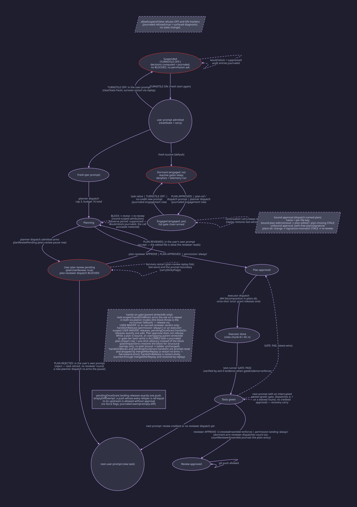

# Gate state machine

All state is keyed per parent session. `replayGrace` gives restart-restored
flags a one-prompt survival window; continuation carry (default on) re-arms
it when a continuing prompt has an unchanged worktree fingerprint and earned
credit (a green test gate or a reviewer approval). A retired task's credit
also rides the same window when the review phase was interrupted mid-flight:
a green test gate, at least one counted reviewer dispatch or waived reviewer
round, and no credited reviewer approval (`isInterruptedReview`,
`src/task-scope.ts`); both the live abort path and the restart-replay path
recover identically, and the journaled `continuation` row carries
`recovery: true` in that case. The recovery re-opens the retired task's
plan-bound scope, which then persists like any live plan-bound green task
(bounded by the ensemble cap and the landing gate, not by prompt count).

### Dormant-until-engaged

Enforcement is dormant by default (`alwaysEnforce: false`). A fresh session's
reactive gates (the dispatch guards for plan, decomposition, budget, and the
reviewer ensemble; the hands-on and bash-write ladders; the landing gate; the
commit lint; and the read horizon) sleep until the pipeline engages. The
user-configured denylists (`toolPolicy.bashDeny` / `toolPolicy.pathDeny`) and
all telemetry (dispatch, landing, hands-on, scratch rows) keep running while
dormant, so the audit trail stays complete. The `engaged` flag on the parent
bucket arms enforcement:

- **Arm**: a prompt carrying the `PLAN APPROVED:` marker (reason
  `plan-approved`), a prompt classified `plan-ref` or `dispatch` by the
  intent classifier (reasons `plan-reference` / `dispatch-request`), or an
  actual planner dispatch (reason `dispatch-request`). Every transition
  journals a `type:"engagement"` row.
- **Sleep**: task retire (`markTaskComplete`, reason `task-complete`), the
  `TURNSTILE OFF:` suspend clear (reason `abort`), and a scope-changing new
  prompt with no continuation credit (reason `continuation-drop`; on a
  carry, `mergeAfterReplay` preserves `engaged` like the other
  restart-sticky flags, and replay restores it last-wins from the journal).
- **Hint**: while dormant, a `work`/`issue`-intent prompt produces exactly
  the existing one-time advisory nudge; a dispatch/plan-ref prompt journals
  its `intent` row but never nudges (engagement replaced the reminder).
  The orchestrator policy head is also gated: a dormant session's context
  and deliveries stay clean of pipeline governance prose.

`alwaysEnforce: true` restores the legacy always-armed behavior in one
branch of the `enforcementArmed` predicate consulted at the four choke
points (`guardedTaskDispatch`, `handleBashDispatch`, `handleWriteEditDispatch`,
`handleReadBudget`); the guards themselves are unchanged.

### What each gate blocks

| Gate               | Guard                                            | Blocks                                                                                                                                                                                                                                                                                                                                                                                                                                                                                                                                                                                                                                                                                                                                                                                                                                                                                                                                                                                                                                | Escape hatches                                                                                                                                                             |
| ------------------ | ------------------------------------------------ | ------------------------------------------------------------------------------------------------------------------------------------------------------------------------------------------------------------------------------------------------------------------------------------------------------------------------------------------------------------------------------------------------------------------------------------------------------------------------------------------------------------------------------------------------------------------------------------------------------------------------------------------------------------------------------------------------------------------------------------------------------------------------------------------------------------------------------------------------------------------------------------------------------------------------------------------------------------------------------------------------------------------------------------- | -------------------------------------------------------------------------------------------------------------------------------------------------------------------------- |
| Reviewer dispatch  | `guardReviewerDispatch`                          | reviewer task until `hasGatePass`; round cap 2 (a scoped waiver spends its own allowance: max 2 waiver-unblocked dispatches on `reviewWaiverRounds`, metered apart from `reviewRounds`)                                                                                                                                                                                                                                                                                                                                                                                                                                                                                                                                                                                                                                                                                                                                                                                                                                               | `userWaiver` covering `reviewer` (unscoped covers every stage)                                                                                                             |
| Plan approval      | `enforcePlanApproval`                            | executor task while any plan the dispatch resolves to (prompt-referenced → session-bound → all pending) is _pending_ — holds neither a current `hasPlanVerdict` (a bound approval (dispatch-named plan) is stale only on that plan's **spec-region** edit/removal (`plan-edited` / `plan-missing`; the key hashes everything from `# Objective` onward, excluding the leading `# Progress` section, via `src/plan-region.ts` — a malformed or missing Progress header falls back to whole-file keying); unbound approvals go stale on any plans-dir change (`signature-mismatch`; a same-content move survives)) nor a durable approved-plan record for this project ([persistence](persistence.md))                                                                                                                                                                                                                                                                                                                                  | `userWaiver` covering `plan-reviewer` or `executor` (the plan-gate stage group; unscoped covers every stage), `PLAN APPROVED:`, permission `always`, one-shot `once` grant |
| Decomposition      | `enforceDecomposition`                           | executor task without a chunk cite when the resolved plan (dispatch-named → session-bound → first sorted _pending_ decomposed) carries `## Decomposition`                                                                                                                                                                                                                                                                                                                                                                                                                                                                                                                                                                                                                                                                                                                                                                                                                                                                             | —                                                                                                                                                                          |
| Loop caps / budget | `guardDispatchBudget`                            | planner>3, plan-reviewer>3, test-runner>4, total>16 — a block on an edge-registered child carries the end-the-turn-and-report clause (it never admits a user prompt) and stamps `parent` on the entries                                                                                                                                                                                                                                                                                                                                                                                                                                                                                                                                                                                                                                                                                                                                                                                                                               | `userWaiver` covering the dispatched stage (unscoped covers every stage); the parent's next prompt (releases the registered children's counters)                           |
| Read horizon       | `guardReadLimit`                                 | whole-file read #15+ per parent (warn once at 8)                                                                                                                                                                                                                                                                                                                                                                                                                                                                                                                                                                                                                                                                                                                                                                                                                                                                                                                                                                                      | —                                                                                                                                                                          |
| Reviewer ensemble  | `reviewEnsembleComplete`                         | landing credit below 2 unwaived reviewer dispatches (a reviewer dispatch admitted on the dormant arm — a session disengaged by `continuation-drop` — also increments the ensemble counter and journals the count entry via `countReviewerEnsemble`, so the credit check stays symmetric with dispatch-time admission; the dormant arm neither consumes nor is bounded by the round cap)                                                                                                                                                                                                                                                                                                                                                                                                                                                                                                                                                                                                                                               | `reviewEnsemble:"advise"`                                                                                                                                                  |
| Landing            | `guardLanding`                                   | `git push` without `hasReviewApprove` — a repeat attempt (or a credited first attempt) journals the permission ask and arms the latch in BOTH `escalation` modes (within-TTL dedupe hits take the block path — the no-human fallback)                                                                                                                                                                                                                                                                                                                                                                                                                                                                                                                                                                                                                                                                                                                                                                                                 | reviewer `VERDICT: APPROVE` / `PLAN APPROVED:` / permission `always` / `once` / provable empty diff (`emptyDiffExempt`)                                                    |
| Hands-on           | `guardHandsOn` / `guardBashWrite`                | parent-session and non-pipeline-subagent `write`/`edit` (always on; a registered pipeline child never gates — a configured pipeline agent name on the event exempts, with the child→parent edge + emitter fallback behind it via `resolveChildStatus`, fail-closed on an unresolved agent; plan approval does not release it) and, via `guardBashWrite` (`toolPolicy.bashWriteGate`, default true), confident file-writing bash commands (`cat > f`, `echo x >> f`, `tee f`, `sed -i`/`--in-place`, `cp`/`mv`/`dd`/`truncate`/`touch`) — output capture (`> /dev/null`, `npm test > log`), `2>&1`, heredoc-bearing commands (`cat <<EOF`: body lines are stdin data, so the command is observed, never gated), `tee /dev/null`/fd-dup operands, and `dd of=/dev/...` never gate, and every write-shaped command journals `handsOn` telemetry via `observeBashWrite` — a repeat attempt journals the permission ask and arms the latch in BOTH `escalation` modes (within-TTL dedupe hits take the block path — the no-human fallback) | `handsOnRelease` (permission `always`), `pendingOnceGrant.handsOn`, `userWaiver` covering `executor` (unscoped covers every stage)                                         |
| Tool policy        | `guardBash` / `guardCommitMessage` / `guardPath` | denied git operations (worktree, branch switch, merge, `gh pr`), non-conforming commit subjects                                                                                                                                                                                                                                                                                                                                                                                                                                                                                                                                                                                                                                                                                                                                                                                                                                                                                                                                       | the denylists default empty — configuring a rule is what turns it on; `TURNSTILE OFF:` suspends session-wide                                                               |

### Observe mode (adoption period)

`observeSessions: N` (default `0`) suppresses the deliberate block for the
first N admitted parent sessions. Every gate above keeps evaluating
unchanged (markers, evidence, and credit are untouched); only the throw is
gated. A `BlockError` from a task-dispatch guard or the read-budget guard is
caught in the hook body (`dispatchBlockOutcome` / `handleReadBudget`),
journaled as a `would-block` entry, and the call proceeds, metered like an
admitted dispatch (tool-policy and git-gate blocks are not suppressed;
their own `mode` knobs govern). The phase is per session: prompt admission
calls `stampObserveAdmission`, which reads `observePhase`. A process-new
session increments the running `observed` total (phase `observe` while
`observed <= N`, `enforce` past it, `off` for `N = 0`, the default path that
stamps and journals nothing) and journals one `observe` entry per first
admission; repeat admissions read the stored phase and journal nothing.
`observeActive` gates the suppression and fails toward enforce: any ledger
throw journals an `error` entry and the block proceeds normally. On the
period-completing stamp, or at boot when the replayed tail shows a
completed period whose summary never surfaced, the `observeSummaryPending`
flag (beside `surfaceObserveSummary`) arms, and the first string-output
delivery after it is prefixed with the
once-per-load `[turnstile] observe:` block (`formatObserveSummary`, rendered
from the `observeCounts()` totals at injection time) and the inert
`kind:"summary"` marker is journaled so a restart never re-fires it.

### Gate suspension overlay

A user-typed `TURNSTILE OFF:` prompt marker (the `suspendMarker` literal,
honored only from admitted user prompts, never agent-dispatchable) suspends
gate enforcement for the session as an overlay on the state machine, exactly
like the observe period but session-scoped instead of adoption-scoped: gate
decisions keep computing and journaling; only the deliberate block (and the
permission asks) are suppressed. The flag lives in the ledger's suspension
map (outside the per-prompt bucket, like the observe period), keyed per
parent; children draw on the parent's suspension via `ledger.parentOf`. At
each deliberate-block site (`dispatchBlockOutcome`, `handleReadBudget`, and
the `guardedToolBefore` choke via `suspendBlock`) the suspension predicate ORs
with `observeActive`, and the observe branch wins the flavor: a suppression
during an observe period journals under the observe totals, otherwise a
`suspended` / `event:"would-block"` audit entry is journaled and the call
proceeds (metered like an admit on the dispatch path). Suspension clears the
session's gate state fresh (`clearState`, the shared reset body with the
`replayGrace` merge disabled) both on OFF and ON, so no credit earned before
or during the suspension rehydrates; a suspension survives a restart (the
journal tail replays it, [persistence](persistence.md)), and `TURNSTILE ON:` (the `resumeMarker`
literal) resumes enforcement with the same fresh start. `allowSuspend:false`
disables the markers: an OFF or ON is refused (`refused:true` journaled + a
parked `[turnstile] marker:` diagnostic) with no state change.

### User plan review (opt-in pause)

With `planUserReview: true` (default `false`, the fully-automated flow), the
pipeline pauses between the planner writing a plan and the plan-reviewer
dispatch: an admitted planner dispatch arms `planReviewPending` (journaled as
a `plan-review` `pause` row), and the next plan-reviewer dispatch is blocked
with a deliberate `BLOCKED by turnstile:` error naming the plans dir and the
two literals. The user edits the plan file if they wish, then accepts or
rejects via their OWN prompt: `planReviewAcceptMarker` (default
`PLAN REVIEWED:`) clears the pause so the reviewer dispatch proceeds (the
edited file is what the reviewer reads at dispatch time), and
`planReviewRejectMarker` (default `PLAN REJECTED:`) retires the task scope
with no counted plan-reviewer dispatch (a new planner dispatch re-arms the
pause). The flag is restart-sticky: it rides `carryStickyFlags` across
task-scope resets and is restored by the last-wins `plan-review` replay fold,
so the pause survives both a restart and the user-prompt boundary. The
literals are admission-only (never agent-dispatchable) and waivers do not
bypass the pause; a prompt carrying neither literal leaves the pause armed
(fail-toward-strict: a lost accept never dispatches an unreviewed plan).

### Requirements phase (opt-in, ungated)

With `requirementsPhase: true` (default `false`; the pipeline is
byte-identical when off), non-trivial tasks dispatch a `requirements` subagent
before the planner: it converts the user's request into a spec (objective,
explicit/implied requirements, constraints, non-goals, numbered acceptance
criteria `AC-1…AC-n`, and Open Questions each marked blocking or
non-blocking). The orchestrator relays any remaining Open Questions to the
user, folds the written answers in (an explicit delegation is recorded with
its scope), and passes the finalized spec verbatim into the planner dispatch
prompt. Trivial tasks (small fixes, renames, doc/config changes) skip the
leg. The phase is soft and ungated: it emits no marker and no gate. The only
enforcement surface is the loop cap (`maxRequirementsRounds`, default 2,
counted in `requirementsRounds` and the total dispatch budget, waived
dispatches exempt) and the injected policy prose
(`requirementsPhaseSection` in `src/policy.ts`, appended under the
`planUserReview` precedent). The leg is not a pipeline stage in the
mechanical `PIPELINE:` successor logic beyond the requirements→planner edge
(`nextStage` in `src/state.ts`, keyed on the optional `PipelineStages.requirements`
name); a requirements dispatch in a still-dormant session is admitted without
engaging enforcement: the planner dispatch that follows engages and runs the
full chain.

### Key `GateState` fields (`src/types.ts`)

| Field                                                                                        | Set by                                                                                                                                                                                                                                                        | Cleared by                                                                                                                                                                                                  | Blocks                                                                                                                                        |
| -------------------------------------------------------------------------------------------- | ------------------------------------------------------------------------------------------------------------------------------------------------------------------------------------------------------------------------------------------------------------- | ----------------------------------------------------------------------------------------------------------------------------------------------------------------------------------------------------------- | --------------------------------------------------------------------------------------------------------------------------------------------- |
| `hasGatePass`                                                                                | first-sight `GATE: PASS`; evidence promotion; replay                                                                                                                                                                                                          | `GATE: FAIL` (latest-wins); prompt reset                                                                                                                                                                    | reviewer dispatch                                                                                                                             |
| `unverifiedPass`                                                                             | `GATE: PASS` without correlated exit-0 test (`gateEvidence:"enforce"`)                                                                                                                                                                                        | green flip; FAIL; task reset                                                                                                                                                                                | reviewer block reason becomes `gate-unverified`                                                                                               |
| `hasPlanVerdict`                                                                             | plan-reviewer APPROVE; `PLAN APPROVED:`; permission `always`; replay                                                                                                                                                                                          | BLOCK; signature mismatch; prompt reset                                                                                                                                                                     | executor dispatch                                                                                                                             |
| `plansSignature`                                                                             | stamped at approval from the path-free plans-dir signature; replayed from the `plansSig` journal field; governs **unbound** approvals only                                                                                                                    | BLOCK; (unbound) plans-dir change ⇒ `signature-mismatch` STALE journaled + re-review                                                                                                                        | stale unbound approvals                                                                                                                       |
| `approvedPlan` / `approvedPlanKey`                                                           | stamped at approval when the dispatch prompt names exactly one existing plan file (replayed from the `plan`/`planKey` journal fields); a bound approval is also recorded in the durable approved-plan sidecar (project-scoped, [persistence](persistence.md)) | BLOCK; the bound plan's edit ⇒ `plan-edited` STALE; its removal ⇒ `plan-missing` STALE; prompt reset                                                                                                        | stale bound approvals (per-plan staleness)                                                                                                    |
| `hasReviewApprove`                                                                           | reviewer APPROVE on task-result delivery, ensemble-gated; landing permission `always`; replay                                                                                                                                                                 | prompt reset                                                                                                                                                                                                | `git push`                                                                                                                                    |
| `userWaiver`                                                                                 | `USER WAIVER:` in the user's prompt only (trace-gated quote, or `<present>` when `trace` is off)                                                                                                                                                              | unscoped: the first reviewer dispatch it unlocks; prompt reset (carried one prompt through `mergeAfterReplay` like the restart-sticky flags)                                                                | every gate while unscoped; the named stages' gates when scoped (the plan gate is covered by `plan-reviewer` or `executor`)                    |
| `userWaiverScope`                                                                            | parsed at capture from the waiver text — the configured agent names named in it (`parseWaiverScope`, `src/markers.ts`); `[]` = unscoped                                                                                                                       | prompt reset (carried one prompt through `mergeAfterReplay` like the restart-sticky flags)                                                                                                                  | none — scopes `userWaiver` to the named stages' gates (a name with no guarded gate scopes it to nothing)                                      |
| `userWaiverConsumed`                                                                         | the reviewer gate consuming an unscoped waiver                                                                                                                                                                                                                | prompt reset (carried one prompt through `mergeAfterReplay` like the restart-sticky flags)                                                                                                                  | none — reports the consumed state to block messages and the compaction snapshot                                                               |
| `reviewWaiverRounds`                                                                         | scoped-waived reviewer dispatches (one allowance slot each)                                                                                                                                                                                                   | prompt reset (carried one prompt through `mergeAfterReplay` like the restart-sticky flags; deliberately not shared with the replay-restored `reviewRounds`)                                                 | reviewer dispatch past the waiver allowance (`maxReviewerRounds` waiver-unblocked dispatches)                                                 |
| `pendingOnceGrant.plan/.landing`                                                             | permission reply `once`                                                                                                                                                                                                                                       | consumed by one executor dispatch / one push                                                                                                                                                                | per-reason keying prevents cross-consumption                                                                                                  |
| `pendingOnceGrant.handsOn`                                                                   | permission reply `once` on a hands-on ask                                                                                                                                                                                                                     | consumed by one parent write/edit or one gate-tier bash write (the bash consume runs inside `guardBashWrite`, after its flag and verdict checks); prompt reset; dropped by `mergeAfterReplay` (task-scoped) | per-reason keying prevents cross-consumption                                                                                                  |
| `handsOnBlocks`                                                                              | `guardHandsOn` on a parent write/edit                                                                                                                                                                                                                         | prompt reset; dropped by `mergeAfterReplay` (task-scoped); never replay-restored (a restart mid-task re-arms the ladder — fail-toward-strict)                                                               | arms the hands-on permission ask on a repeat attempt in BOTH `escalation` modes (`prior >= 1`; the block-throw is only the no-human fallback) |
| `handsOnRelease`                                                                             | permission reply `always` on a hands-on ask                                                                                                                                                                                                                   | prompt reset; restart-sticky — carried through `mergeAfterReplay` and restored by replay (a restart mid-task keeps it)                                                                                      | standing release of the hands-on gate for the task                                                                                            |
| `reviewRounds`, `plannerRounds`, `planReviewerRounds`, `testRunnerRounds`, `totalDispatches` | dispatch guards                                                                                                                                                                                                                                               | prompt reset                                                                                                                                                                                                | round caps / budget                                                                                                                           |
| `reads`                                                                                      | `execute.before` increments; `execute.after` corrects a failed read                                                                                                                                                                                           | prompt reset                                                                                                                                                                                                | warn once at 8 / block 15                                                                                                                     |
| `readWarned`                                                                                 | first string-output read at-or-past `readWarn`                                                                                                                                                                                                                | prompt reset                                                                                                                                                                                                | read-budget warn injection (once per task)                                                                                                    |
| `replayGrace`                                                                                | journal replay; continuation-carry re-arm                                                                                                                                                                                                                     | consumed by first `resetState`                                                                                                                                                                              | one-prompt survival of restored flags                                                                                                         |
| `taskFingerprint`                                                                            | stamped when continuation carry is enabled (default on)                                                                                                                                                                                                       | new stamp                                                                                                                                                                                                   | identity signal for carry                                                                                                                     |
| `lastGateMarker`, `lastVerdictMarker`                                                        | stamped at first-sight `GATE:`/`VERDICT:` (de-tokenized, so they cannot re-parse)                                                                                                                                                                             | prompt reset                                                                                                                                                                                                | rendered into the compaction snapshot; display only, never enforces                                                                           |
| `engaged`                                                                                    | engagement capture (`PLAN APPROVED:` prompt, `plan-ref`/`dispatch` classified prompt); an actual planner dispatch; replay (last-wins `engagement` row)                                                                                                        | task retire (`markTaskComplete`); `TURNSTILE OFF:` clear; a no-credit scope-changing prompt reset (journaled `continuation-drop`); restart-sticky otherwise — carried through `mergeAfterReplay`            | arms the reactive gates (dormant-until-engaged); display in the compaction snapshot (`- engaged: yes/no`)                                     |
| `planReviewPending`                                                                          | an admitted planner dispatch while `planUserReview` is on (journaled `plan-review` `pause` row); replay (last-wins `plan-review` row)                                                                                                                         | the `planReviewAcceptMarker` capture; the `planReviewRejectMarker` capture (which also retires the task); restart-sticky otherwise — carried through `carryStickyFlags`/`mergeAfterReplay`                  | plan-reviewer dispatch (the user plan-review pause; only while `planUserReview` is on)                                                        |
