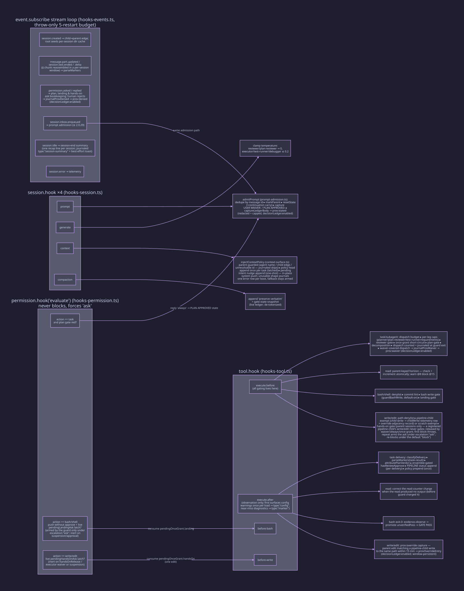

# Hooks: where the plugin intercepts the host

Before any registration, `setup(h)` runs the host-compat guard
(`src/host-compat.ts`): the host version (`app.version`) is compared against
the shipped range (`HOST_COMPAT`, ≥ 2.0.22 and < 3.0.0). An **incompatible**
host is journaled (`type:"compat"`, `event:"incompatible"`), toasted with the
upgrade instruction, and turnstile degrades to a full no-op: no hook is
registered and the heartbeat carries `compat:"incompatible"`. An **unknown**
host (version unreadable or unparseable) enforces as usual and journals a
one-time `compat` warning (`event:"unknown-host"`); its heartbeat reads
`compat:"unknown"`. A **compatible** host proceeds byte-identically to the
pre-guard behavior with `compat:"compatible"` on the heartbeat. The guard is
fail-open: evaluation or toast failures are journaled, never thrown.

`setup(h)` then registers eight interception points, each tracked for disposal and
counted into the load heartbeat (`type:"setup"`). The hook bodies live in the
per-surface modules named below; `setup.ts` wires them and owns the lifecycle.

**`session.hook` ×4** (`hooks-session.ts`)

- **`prompt`** → `admitPrompt` (`prompt-admission.ts`): the single
  prompt-admission body, shared with the inbox stream and deduped on the
  host message id. Its concerns, in order:
  - _Admission and reset._ The body marks the session a live parent and
    performs `resetState`. When the worktree is unchanged, continuation
    carry rides along via `fingerprint.ts`. The reset releases the
    session's edge-registered children's metering counters; freeing at
    least one journals `type:"child-reset"`. It also clears evidence and
    latches.
  - _Waiver and approval capture._ The body captures `USER WAIVER:` /
    `PLAN APPROVED:` literals. A waiver capture also parses its scope, the
    configured agent names named in the waiver text (`parseWaiverScope` in
    `src/markers.ts`), into `userWaiverScope`.
  - _Suspend and resume._ `captureSuspend` scans for the configured
    `suspendMarker` / `resumeMarker` literals (defaults `TURNSTILE OFF:` /
    `TURNSTILE ON:`) by strict `indexOf`; the later-occurring marker wins,
    and the winning action is journaled `type:"suspended"`. An OFF suspends
    enforcement for the session (fresh-start state clear via `clearState`,
    no restart-sticky merge); an ON resumes it (also fresh: no credit
    earned while suspended rehydrates). When `allowSuspend:false`, both
    markers are refused: journaled `refused:true` (with the refused
    marker's `action`) plus a parked marker-style diagnostic; no state
    changes, and the refused entry folds replay-inert (a refusal can never
    resurrect a suspension after a restart). When an allowed OFF shares the
    prompt with `PLAN APPROVED:` or `USER WAIVER:`, the waiver/approval is
    captured first and then wiped by the fresh-start clear (the clear is
    authoritative), with a skip notice journaled.
  - _Near-miss diagnostics._ The body scans the text for marker-shaped
    near misses of the two literals (case, separator, or colon variants).
    This is diagnostic-only: the strict literal capture is untouched, the
    hits are journaled `type:"marker"` and parked for one-shot surfacing.
  - _Intent nudge._ Under `intentNudge` (default on), admission also
    classifies the prompt via `classifyIntent` (`src/intent.ts`). A
    detected implementation intent with no plan approval in the same
    admission journals `type:"intent"` (sessionID + signal kind) and arms
    a one-shot advisory nudge (one nudge per detected intent signal per
    session; a plan approval clears the latch). The nudge is delivered by
    prepending marker-syntax-free advisory prose to the first task
    delivery or the parent's own read delivery (`prependIntentNudge` /
    `prependIntentNudgeRead` in `hooks-core.ts`'s delivery helpers, text
    from `intentNudge` in `src/policy.ts`). Advisory only: nothing gates,
    and a throw in classification journals `type:"error"` and never
    propagates from the prompt path.
  - _Decision-ledger capture._ `captureLedgerBody`
    (`src/prompt-admission.ts`), placed after the dedupe check and after
    the approval/waiver capture sequence, journals one `prov:stated` entry
    per admitted parent prompt, verbatim after redaction, capped at 2000
    chars, no relevance filtering ("continue" included). Pipeline-child
    dispatch prompts are skipped, and the capture is gated on
    `decisionLedger.enabled` (default `true`, [configuration](configuration.md)). Because it lives inside
    the single deduped admission body, both transport paths (the prompt
    hook and the inbox stream) capture exactly once.
- **`generate`** → decoding clamps (`applyClamps`): reviewer/plan-reviewer
  temperature forced to 0; executor/test-runner/debugger clamped ≤ 0.2, plus
  one-per-boot draft telemetry (`observeRequestDraft`, a bounded
  `type:"generate-draft"` descriptor). Background generations (goal judge,
  warming) stay clean of policy prose.
- **`context`** → the primary-turn surface (pre-first-model-call; on v2.2.x
  hosts the main conversation turn fires `session.context`, not
  `session.generate`). Its concerns:
  - _Clamps and draft observation._ The body applies the same decoding
    clamps via the shared `applyClamps` helper (registering both hooks
    repairs the clamp gap: primary turns never rode `session.generate`)
    and observes the draft once per boot.
  - _Policy injection._ `injectContextPolicy` (`context-surface.ts`)
    injects the orchestrator policy head (`orchestratorPolicyFor`) and any
    pending intent nudge into the draft's `system` array in place; the
    host builds the model request from the same object, so the prose
    precedes the first model call.
  - _Parent guard._ Injection is parent-guarded: a config-known pipeline
    agent name on the draft, a registered child→parent edge
    (`ledger.childToParent`), or an unresolvable session id each skips
    with a journaled `reason` (`context-agent` / `context-child` /
    `context-no-id`).
  - _Shared latch._ The shared `policyInjected` latch (src/state.ts)
    dedupes against the `execute.after` prepend (whichever channel fires
    first wins), and the nudge is consumed one-shot from the same pending
    map.
  - _Fail-open degradation._ An unusable draft shape journals one
    `type:"error"` row per boot and degrades to the `execute.after`
    fallback channel; a head append failure keeps the nudge pending;
    nothing ever throws.
- **`compaction`** → appends a system block demanding verbatim preservation of
  open findings, AC status, and the last GATE/VERDICT markers, then the live
  gate-state snapshot (`formatGateSnapshot`) from the ledger, so the demand
  arrives with the concrete state beside it. The snapshot's `GATE:`/`VERDICT:` tokens are de-tokenized
  (leading token lowercased) so it can never re-parse as an authoritative
  marker. It reads, never mints, the parent bucket via `ledger.peek`,
  keyed off `draft.sessionID` and falling back to the last-admitted parent
  whenever parent resolution yields no bucket; both paths degrade to
  instruction-only (fail-open, no mint, no journal spam).

**`tool.hook("execute.before")`** (`hooks-tool.ts`): _all gating lives here_:

- `task`/`subagent`: dispatch budget (16 total), per-leg caps
  (planner 3 / plan-reviewer 3 / test-runner 4 / requirements 2, the last
  consulted only while `requirementsPhase` is on), plan-approval gate,
  decomposition gate, reviewer gate (green tests + round cap 2), one-shot
  grants; a waiver-covered dispatch additionally journals one `prov:waiver`
  decision-ledger row at its gate site ([persistence](persistence.md)); the counters advance at guard
  exit, only for admitted dispatches.
- `read`: parent-keyed read horizon (warn at 8 whole-file reads, once per task; block at 15).
- `bash`/`shell`: bash denylist → commit-message lint → hands-on bash
  telemetry + write-shaped bash gate (parent sessions and non-pipeline
  subagents; a registered pipeline child's own file-writing bash is the
  executor's own work and never gates, keyed off the event's agent name with
  the child→parent edge + emitter fallback behind it (`resolveChildStatus`),
  fail-closed on an unresolved agent, after the telemetry row is journaled;
  while a plan is bound, a gate-tier write command is first classified
  against the plan's scope by the plan-impact advisory (containment
  matching on the command text), and an overlapping command is allowed with
  a journaled `plan-impact` row instead of the block, `planImpactStrict`
  delegating structural overlap back into the ladder)
  → landing gate (with the empty-diff
  exemption, default on: ref-equality with upstream, force pushes always
  gate; `false` opts out).
- `write`/`edit`: a guard chain, evaluated in order:
  - _Denylist._ The path denylist decides first; its decision wins over
    everything below.
  - _Scratch exemption._ A target resolving under the platform temp dir is
    zero-governance scratch work, allowed with a
    `{type:"tool", scratch:true}` audit row carrying the target path,
    before any once-grant consume or ladder run.
  - _Child exemption._ The hands-on gate covers parent sessions and
    non-pipeline subagents; a registered pipeline child's write/edit is
    the executor's own work and never gates. The exemption keys off the
    event's agent name first (a configured pipeline name alone exempts),
    with the child→parent edge + emitter fallback behind it
    (`resolveChildStatus`), so an unresolved or non-pipeline agent fails
    closed. The denylist decision wins first and the journal reasons stay
    disjoint.
  - _Planner write-target guard._ Inside the child exemption, a planner
    child's write/edit is additionally confined to the configured
    `plansDir`. The agent name resolves by the same precedence (event name
    first, emitter fallback second; an unresolved name is not a planner —
    fail-open). Scratch targets and empty paths are allowed. A target
    outside the configured plans directory (resolved against the session's
    project dir, relative and absolute `plansDir` both honored) journals
    `{type:"blocked", reason:"planner-write-outside-plans-dir"}` and
    throws `BLOCKED by turnstile:` naming the configured directory and the
    corrective action; an internal error journals `type:"error"` and never
    blocks.
  - _Plan-impact advisory._ While a plan is bound and the session is
    engaged, the advisory runs after the once-grant consume: a target
    overlapping the plan's scope (equality matching on the path; the plan
    file itself is always structural) is allowed with a journaled
    `plan-impact` row and a one-shot advisory prepended to the next
    delivery instead of the block. `planImpactStrict: true` restores the
    block for structural overlap only. An equality target outside the
    project dir classifies `uninspectable` and falls through to the
    hands-on ladder with no journal row. With no plan bound the hands-on
    ladder is unchanged.

  The deliberate blocks above (bash denylist, commit lint, landing gate) all
  rethrow through the same `guardedToolBefore` choke point in `setup.ts`,
  which is also where a session's gate suspension takes them: while
  suspended, the BlockError is journaled (`type:"suspended"`,
  `event:"would-block"`) and the tool call proceeds ([gates](gates.md)).

**`tool.hook("execute.after")`** (`hooks-tool.ts`): observation only, never blocks. First surfaces any
config-validation warnings once per load (a `[turnstile] config:` block
prepended to the first string-output result, journaled `type:"config"`), then
surfaces pending near-miss marker diagnostics once per prompt batch (a
`[turnstile] marker:` block prepended to the first string-output result of a
parent with a parked hit, journaled `type:"marker"` / `surfaced`), then
parses markers out of task deliveries, attributes plan verdicts, credits reviewer
approval (ensemble-gated); both on the delivery's agent, resolved through the
child→parent edge + host session record when the dispatch input names none —
appends the per-delivery `PIPELINE:` status tail
(skipped when the delivery's agent is not a pipeline stage), prepends the
orchestrator policy head once per task (the first pipeline delivery reads
head+tail, later deliveries tail-only),
corrects the read counter charge down when a read produced no string output
(`execute.before` charged it on the guard), and promotes an `unverifiedPass`
when a correlated exit-0 test execution appears (the same correlation
re-checks when a child→parent edge resolves late (a background dispatch, via
`session.created` or `session.get`) and again at reviewer-dispatch time,
bounded to the parent's current task window (stamped at prompt admission).

**`permission.hook("evaluate")`** (`hooks-permission.ts`): never blocks. When the plan gate is red on
a task dispatch (the host exposes the action as `subagent` on current hosts and `task` on older hosts
within the supported compat range), the task arm's behavior follows `escalation`: under `"ask"` it _forces_ an interactive
`ask` to the user, while under the default `"block"` it stays inert (the dispatch guard
(`enforcePlanApproval`) blocks with the stop-and-report instruction and release flows via
`PLAN APPROVED:` plus the sticky waiver/ask paths. The landing arm does the same when a push lacks reviewer approval and the
parent carries a live `pendingLandingAsk` latch; the write/edit arm does the
same for the hands-on gate: a
parent `write`/`edit` with a live `pendingHandsOnAsk` latch (each armed by the
guard in BOTH `escalation` modes; the ask-first ladder arms the one-shot ask
latch on the armed repeat attempt; the block-throw is only the no-human
fallback, so both arms fire the ask whenever the latch is live) is forced to
`ask`. Replies are matched to recorded ask request-IDs only:
`always` stands a verdict/approval, `once` releases exactly one dispatch/push/edit,
`reject` keeps the gate red. Both arms are inert while the parent's gate
enforcement is suspended (the [suspension overlay](gates.md#gate-suspension-overlay)): the task arm returns
before the ask and its latch, and the landing arm returns after deleting the
parent's armed `pendingLandingAsk` latch (the one-shot consume), so a latch
armed before the suspension cannot fire a mislabeled landing ask after a
`TURNSTILE ON:` resume; the guard re-arms on a fresh repeat attempt. The
landing and hands-on arms consume their latches the same one-shot way, and
all three arms are inert when the parent's gate state carries the matching
standing release (`handsOnRelease` / an executor-scoped waiver).

**`event.subscribe` loop** (`hooks-events.ts`): child→parent edges (`session.created`), marker
parsing from streamed child text (`message.part.updated`,
`session.text.ended`, `session.text.delta`): each `GATE:`/`VERDICT:`
observation is applied only when the emitting session's agent holds the marker
contract for that kind (a `GATE:` from `test-runner`, a `VERDICT:` from
`reviewer` / `plan-reviewer`), and a denied observation is journaled
`suppressed` rather than flipping state, permission ask/reply bookkeeping
(whose three human-reject sites, the plan, landing, and hands-on ask
replies, each journal one `prov:denied` entry via `journalProvDenied`
(`src/event-stream-handlers.ts`), carrying the ask `kind`; gated on
`decisionLedger.enabled`, replay-inert),
prompt admission via `session.inbox.enqueued` (opencode ≥ 2.0.29; an
additive channel the host publishes immediately after the prompt hook fires,
deduped against the hook path on the shared host message id), background
subagent-completion parsing on the same event (opencode ≥ 2.0.29: a
synthetic item with `metadata.source === "subagent"` carries a background
child's final text, which turnstile parses child-keyed under the
`subagent-synthetic` source with a per-child dedup scope (so one child's or a
streamed source's identical marker never suppresses another child's credit,
while a durable-event replay still dedupes) and credits through the
child→parent edge, so a
background plan-reviewer's `VERDICT: APPROVE` moves the plan-approval gate
the same way a foreground tool result does; on 2.0.22–2.0.28 the event does
not exist and completions arrive as foreground tool results), the
session-end summary (`session.idle`, one recap line per session, see the
`session-summary` entry kind in [persistence](persistence.md)), and error
telemetry. Streamed child text
is ingested through a per-session sliding window: a marker the host splits
across `session.text.delta` chunks is reassembled and re-parsed so a completed
marker is first-sighted once (dedup-suppressing the re-parse), then the window
ages out on the next task dispatch. A subscription that throws is
journaled per death and the consumer re-subscribes under a cumulative
budget of 5 restarts; the disablement journals once, then
`session.text.*` ingestion stops. A clean host recycle (a stream that
completes without abort) re-subscribes for free and never spends the
budget, its stream-ended telemetry journaling once per stop rather than
once per close (an aborted exit stays silent).
