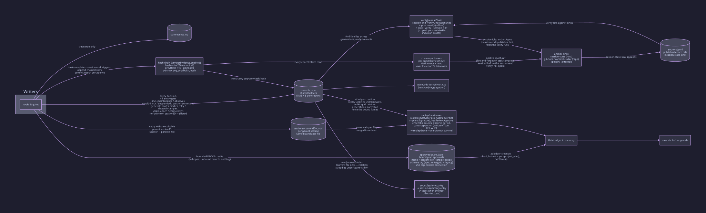

# Persistence: journal and restart

The journal is the plugin's only persistence edge. It lives outside the
repo at `~/.local/share/opencode/metrics/`. The store is a shared
`turnstile.jsonl` plus a per-session `sessions/<parentID>.jsonl` sink
(`journalPerSession`, default on). `gate-events.log` (trace only),
`anchors.jsonl`, and `approved-plans.jsonl` sit beside them. Retention is
bounded: 5 MB per file, 5 generations per file. `replayTailLines` (default 2000) bounds the boot window.
The standalone `evidence` emitter is the one external writer: each
artifact write appends one unchained `event:"emit"` row and mirrors the
artifact to `sessions/<parentID>/evidence.json` beside the session's sink
(best-effort, fail-open).

On restart, `replayGatePasses` (`src/ledger.ts`) walks the generations
newest-first. It merges by `ts` and folds last-wins per session. It
restores gate flags, verdicts, ensemble counts, the observe period, and
the suspension map. The `prov:stated` / `prov:denied` / `prov:waiver` /
`prov:override` decision-ledger rows ride the same journal. Every read
error is fail-open: the journaler records it and never throws.

Concurrent OpenCode instances sharing the metrics dir append safely:
chained journal rows and the approval sidecar write inside a per-file
`<file>.lock` mkdir mutex (`src/lockfile.ts`) with the chain head (or
sidecar) re-read from disk inside the critical section; contention past
the retry bound degrades to an unlocked write with a journaled
`journal-lock:` row — never a blocked or dropped row. See
[journal/chain.md](../journal/chain.md) for the locking contract.

The full catalog lives in [journal/entry-types.md](../journal/entry-types.md). It lists every entry
type with its replay fold, the file layout, rotation
mechanics, and the tamper-evidence hash chain.
