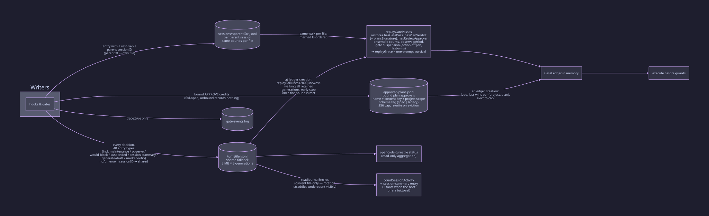

# Persistence: journal and restart

The journal is the plugin's only persistence edge. It lives outside the
repo at `~/.local/share/opencode/metrics/`. The store is a shared
`turnstile.jsonl` plus a per-session `sessions/<parentID>.jsonl` sink
(`journalPerSession`, default on). `gate-events.log` (trace only),
`anchors.jsonl`, and `approved-plans.jsonl` sit beside them. Retention is
bounded: 5 MB per file, 5 generations per file. `replayTailLines` (default 2000) bounds the boot window.

On restart, `replayGatePasses` (`src/ledger.ts`) walks the generations
newest-first. It merges by `ts` and folds last-wins per session. It
restores gate flags, verdicts, ensemble counts, the observe period, and
the suspension map. The `prov:stated` / `prov:denied` / `prov:waiver` /
`prov:override` decision-ledger rows ride the same journal. Every read
error is fail-open: the journaler records it and never throws.

The full catalog lives in [journal.md](../journal.md). It lists the 43 entry
types enumerated by the inventory in docs/journal.md (the old prose count was 42; all
literals are listed) with their replay folds, the file layout, rotation
mechanics, and
the tamper-evidence hash chain.
