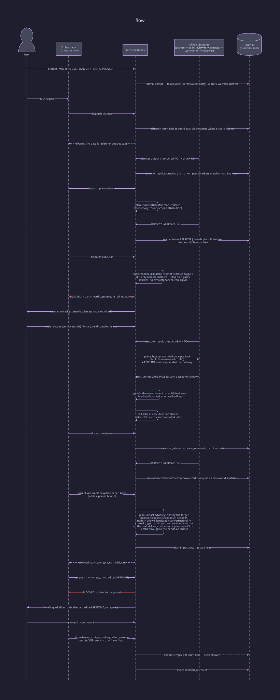

# A task, end to end

The three lifelines: orchestrator (parent session), child subagent sessions,
and the journal, the only persistence edge.

A typical enforced run:

1. The user's prompt is admitted; a new task resets prior gate state (or
   carries earned flags across a continuation prompt with an unchanged
   worktree fingerprint).
2. The planner runs (subject only to loop caps); its `AC-n`/`chunk-N` plan
   lands in `.opencode/plans/`. With `requirementsPhase: true` a
   non-trivial task first dispatches the requirements subagent, whose spec
   (after the Open Questions round-trip) is passed verbatim into the planner
   dispatch (see [Requirements phase](gates.md#requirements-phase-opt-in-ungated)).
3. The plan-reviewer must APPROVE. A BLOCK dead-ends nothing: the plan is
   revised and re-review is attributed via round-scoped evidence (the newest
   dispatched plan-reviewer round wins within the parent).
4. The executor is gated on plan approval (keyed on the plan's **spec
   region**; the plan-approval row in [gates.md](gates.md) defines the hashing). Its result must
   cite `chunk-N` / `AC-n` entries from the decomposition. A **maintenance
   dispatch** (prompt declares maintenance scope for the live bound plan and
   the working-tree diff touches only non-src surfaces) rides a lighter
   path: it skips the plan-approval and decomposition gates and is capped at
   4 per plan. Eligibility is canonical in `src/maintenance.ts`; the journaling
   semantics are in [journal.md](../journal.md)'s `maintenance` entry.
5. The test-runner's `GATE: PASS` may require corroborating exit-0 bash
   evidence (`gateEvidence:"enforce"`); without it the flag is held as
   `unverifiedPass` and promoted when evidence arrives, including when a
   late child→parent edge back-fills the correlation, and only for
   executions journaled within the parent's current task window.
6. The reviewer's APPROVE credits the landing gate; under
   `reviewEnsemble:"enforce"` only after ≥2 unwaived reviewer dispatches.
7. `git push` is blocked until reviewer approval exists; the interactive
   landing ask arms immediately when the session carries a credited reviewer
   APPROVE that the prompt reset just dropped, and on a repeat push otherwise.
