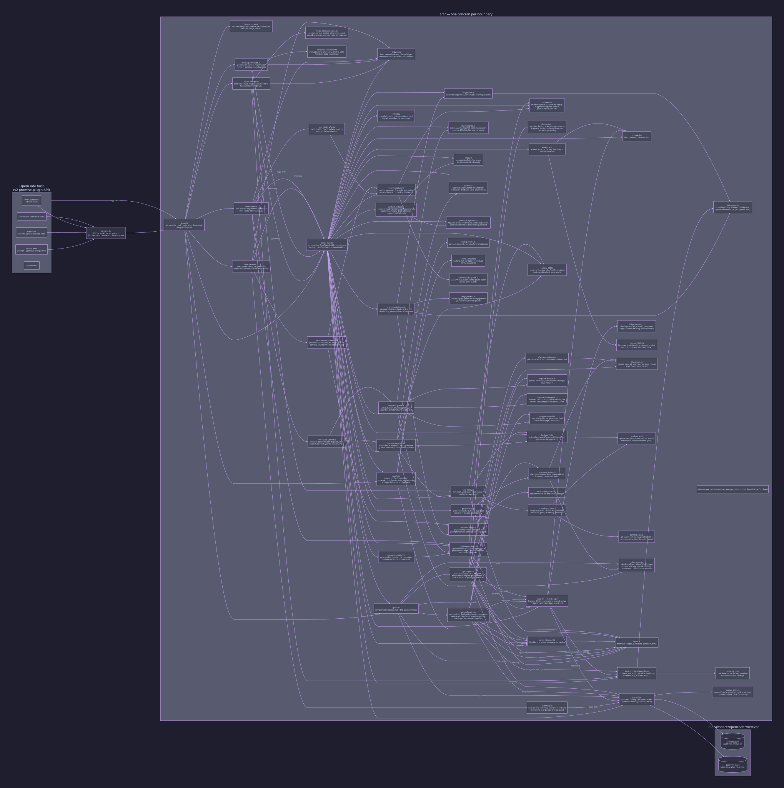

# Module map

One boundary per file under `src/`; dependencies flow one way, no cycles.
`turnstile.ts` stays a thin entry point (`{ id: "turnstile", server, setup }`;
`server` is a legacy v1 shim).

This is the developer reference extracted from the architecture docs
([architecture.md](architecture.md) and the section files under
[architecture/](architecture/)); the narrative (hooks, gates, task flow)
lives there.

Source: `docs/diagrams/d01-modules.d2`; re-render with `d2 --theme 200 docs/diagrams/d01-modules.d2 docs/images/d01-modules.svg`.

| Module                          | Responsibility                                                                                                                                                                                                                                                                                                                                                                                                                                                                                                                                                                                                                                                                                                         |
| ------------------------------- | ---------------------------------------------------------------------------------------------------------------------------------------------------------------------------------------------------------------------------------------------------------------------------------------------------------------------------------------------------------------------------------------------------------------------------------------------------------------------------------------------------------------------------------------------------------------------------------------------------------------------------------------------------------------------------------------------------------------------- |
| `turnstile.ts`                  | Entry point: module shape + factory; its doc comment is a contract-level summary pointing at `docs/architecture.md` as the authoritative reference                                                                                                                                                                                                                                                                                                                                                                                                                                                                                                                                                                     |
| `src/setup.ts`                  | Wiring only: the host-compat guard verdict, hook registration (per-surface hook modules below), the load heartbeat, lifecycle/disposal                                                                                                                                                                                                                                                                                                                                                                                                                                                                                                                                                                                 |
| `src/host-compat.ts`            | Host-version guard: semver parse/compare, the shipped compat range, and the verdict; fail-open — consumed only by `setup.ts` and the tests                                                                                                                                                                                                                                                                                                                                                                                                                                                                                                                                                                             |
| `src/hooks-core.ts`             | Composition root: builds the per-setup `CoreState` (deps, bounded maps, constants, holders, bound helper fields) via small `buildCore*` state builders, wires the seven concern modules below against it, and assembles the returned `TurnstileContext` with `coreContext` — no hook bodies and no concern logic live here                                                                                                                                                                                                                                                                                                                                                                                             |
| `src/context-surface.ts`        | Context-surface concern: the once-per-load model-facing injections — config warnings, the end-of-period observe summary, the generation-draft telemetry, and the primary-turn context policy head with its pending intent nudge; threaded the shared `CoreState`                                                                                                                                                                                                                                                                                                                                                                                                                                                       |
| `src/parent-resolution.ts`      | Parent-resolution concern: resolving a child session's parent edge and project directory through the host session API (negative caching, bounded retries), the emitter-authority cache deciding marker authority, and the boot re-seed rebuilding both from replayed edges                                                                                                                                                                                                                                                                                                                                                                                                                                             |
| `src/verdict-capture.ts`        | Verdict-capture concern: parsing `GATE:`/`VERDICT:` markers out of assistant text, journaling first-sight observations, recording streamed verdicts into the child store, and the `lastMatch` helper the attribution paths share                                                                                                                                                                                                                                                                                                                                                                                                                                                                                       |
| `src/plan-verdict.ts`           | Plan-verdict concern: attributing a plan-reviewer verdict to the parent's plan-approval gate (edge-first, then the unique unanimous unresolved pool), applying approval bindings, and recording the durable plan identity under the project                                                                                                                                                                                                                                                                                                                                                                                                                                                                            |
| `src/dispatch-guard.ts`         | Dispatch-guard concern: the `task`/`subagent` execute.before path — the dispatch prologue (agent resolution, parent pinning, delta age-out, plan-reviewer round bookkeeping), the guard-and-meter chain, and the single admitted-dispatch exit                                                                                                                                                                                                                                                                                                                                                                                                                                                                         |
| `src/bash-write-guard.ts`       | Bash/write-guard concern: the `bash`/`shell` and `write`/`edit` execute.before paths — denylist guards, commit lint, landing and bash-write telemetry, scratch/pipeline-child exemptions (the pipeline-child arm journals the `childWrite` telemetry row and records the override adjacency), the plan-impact advisory, the hands-on and landing ladders, `session_move` telemetry                                                                                                                                                                                                                                                                                                                                     |
| `src/prompt-admission.ts`       | Prompt-admission concern: the single admission body for a user-authored prompt (dedupe, dead-channel telemetry, task-scope decision, capture sequence), the task-scope reset/carry machinery, and the prompt-channel captures (waiver, approval, task-done, suspend/resume, near-miss, observe stamp)                                                                                                                                                                                                                                                                                                                                                                                                                  |
| `src/decision-ledger.ts`        | Pure `prov:*` entry builders for the decision ledger (`provStatedEntry`, `provDeniedEntry`, `provWaiverEntry`, and `provOverrideEntry`): redact-then-truncate shaping, no I/O, no classification; payloads stay canonically serializable (stable key order, no non-JSON values) so a later hash chain needs no row migration                                                                                                                                                                                                                                                                                                                                                                                           |
| `src/decision-ledger-redact.ts` | Pure secret redaction (`redactSecrets`) over a fixed, ordered pattern list (`SECRET_PATTERNS` — API keys, AWS access keys, bearer/authorization headers, GitHub tokens, key/token assignments, private-key blocks), replacing each match with `[REDACTED]`; not user-configurable in v1, never throws                                                                                                                                                                                                                                                                                                                                                                                                                  |
| `src/hooks-session.ts`          | Session-surface registration: binds the prompt/generate/context/compaction hooks to the bodies in `hooks-session-bodies.ts`                                                                                                                                                                                                                                                                                                                                                                                                                                                                                                                                                                                            |
| `src/hooks-session-bodies.ts`   | Session-surface hook bodies: prompt-admission counting (the dead-channel telemetry key), the pipeline-agent decoding clamps shared by the generate and context hooks, the primary-turn context body, and the compaction snapshot                                                                                                                                                                                                                                                                                                                                                                                                                                                                                       |
| `src/generate-injection.ts`     | Request-draft surface primitives: the usable-shape guard (`usableRequestDraft`), the in-place `appendSystemText` mutation, and the bounded content-free draft descriptor (`describeRequestDraft`) — pure, consumed by `context-surface.ts`                                                                                                                                                                                                                                                                                                                                                                                                                                                                             |
| `src/hooks-permission.ts`       | Permission-surface registration: binds the `evaluate` hook to the arms in `permission-evaluate.ts` (never blocks, forces `ask`)                                                                                                                                                                                                                                                                                                                                                                                                                                                                                                                                                                                        |
| `src/permission-evaluate.ts`    | Permission-surface evaluate arms: the task-dispatch plan-gate escalation arm, the bash/shell landing-gate arm, and the write/edit hands-on-gate arm, plus the shared one-shot latch-consume helper — the payload carries no tool input, so arms read latches the guards armed                                                                                                                                                                                                                                                                                                                                                                                                                                          |
| `src/hooks-tool.ts`             | Tool-surface registration: binds `execute.before`/`execute.after` to the routers in `tool-hooks-before.ts`/`tool-hooks-after.ts`                                                                                                                                                                                                                                                                                                                                                                                                                                                                                                                                                                                       |
| `src/tool-hooks-before.ts`      | Tool-surface execute.before router: routes the tool call to its guard — task/subagent dispatch (`dispatch-guard.ts`), the parent-keyed read budget, the bash/shell and write/edit guards (`bash-write-guard.ts`), and `session_move`                                                                                                                                                                                                                                                                                                                                                                                                                                                                                   |
| `src/tool-hooks-after.ts`       | Tool-surface execute.after body: the once-per-scope surface blocks (observe summary, config block, near-miss diagnostics) followed by the per-tool delivery bodies — task/subagent delivery classification, emitter seeding, marker parsing, verdict capture + attribution, the bare-output compliance re-prompt, and the write/edit `prov:override` capture                                                                                                                                                                                                                                                                                                                                                           |
| `src/override-adjacency.ts`     | In-memory child-write adjacency for `prov:override` capture: records pipeline-child write target paths per parent (bounded, window-pruned) and matches a later parent write/edit to the same path within `OVERRIDE_WINDOW_MS`; no I/O, never reads child session content                                                                                                                                                                                                                                                                                                                                                                                                                                               |
| `src/hooks-events.ts`           | Event-surface stream loop: subscription, per-event dispatch to `event-stream-handlers.ts`, and re-subscription under a throw-only restart budget                                                                                                                                                                                                                                                                                                                                                                                                                                                                                                                                                                       |
| `src/event-stream-handlers.ts`  | Event-stream per-event handlers: the dispatch table consumed by the stream loop — child→parent resolution and marker parsing from child sessions, permission ask/reply bookkeeping (plan/landing/hands-on latches), inbox admission, the session-end summary, error telemetry                                                                                                                                                                                                                                                                                                                                                                                                                                          |
| `src/delivery.ts`               | Host payload delivery: result-shape classification, text mutation (policy head/tail, config/marker blocks), candidate-key tables, ask-message prefixes                                                                                                                                                                                                                                                                                                                                                                                                                                                                                                                                                                 |
| `src/config.ts`                 | Four-layer config composition (code defaults ⊕ `~/.config/opencode/turnstile.json` ⊕ env ⊕ injected opts) + `configDigest`; the per-section merge arms live in `config-merge.ts`, the per-key validation and resolved invariants in `config-validate.ts`                                                                                                                                                                                                                                                                                                                                                                                                                                                               |
| `src/config-merge.ts`           | Config-merge boundary: per-section patch merging for `mergeConfig` and the `agents`/`toolPolicy`/`gitGates` default sub-objects; warning strings byte-identical to the historical arms                                                                                                                                                                                                                                                                                                                                                                                                                                                                                                                                 |
| `src/config-validate.ts`        | Config-validation boundary: scalar patch-value validation and the post-merge resolved-config invariants; pure decision logic with byte-identical warning strings                                                                                                                                                                                                                                                                                                                                                                                                                                                                                                                                                       |
| `src/state.ts`                  | Gate-state shape: metering-counter clearing, snapshot and pipeline rendering; the fresh-bucket factory and the replay/continuation carry merge live in `state-carry.ts` (re-exported)                                                                                                                                                                                                                                                                                                                                                                                                                                                                                                                                  |
| `src/state-carry.ts`            | State-carry boundary: the fresh gate-state bucket factory (`newState`) and the replay/continuation carry merge (`mergeAfterReplay`); pure bookkeeping — the ledger owns persistence                                                                                                                                                                                                                                                                                                                                                                                                                                                                                                                                    |
| `src/ledger.ts`                 | `GateLedger`: per-parent `GateState` buckets (LRU), child-verdict store, journal replay, live-parent eviction protection; the child→parent edge maps, the live-parent registry, and the credit-bearing APPROVE trace live in `ledger-registry.ts`                                                                                                                                                                                                                                                                                                                                                                                                                                                                      |
| `src/ledger-registry.ts`        | The ledger's parent-edge registry and credit trace: the child→parent edge maps (journaling, re-seed, child-release), the live-parent registry protecting `states` buckets from LRU eviction, and the bucket-free credit-bearing reviewer APPROVE trace                                                                                                                                                                                                                                                                                                                                                                                                                                                                 |
| `src/markers.ts`                | Canonical `GATE:`/`VERDICT:` regex compilation, dedup with first-sight provenance, cross-child suppression, near-miss detection; the GATE/VERDICT parse arms live in `gate-markers-parse.ts`                                                                                                                                                                                                                                                                                                                                                                                                                                                                                                                           |
| `src/gate-markers-parse.ts`     | Gate-marker parsing boundary: the GATE/VERDICT marker arms extracted from `parseGateMarkers` — pure with respect to journal and filesystem (the caller journals the returned events); the regex literals stay canonical in `markers.ts`                                                                                                                                                                                                                                                                                                                                                                                                                                                                                |
| `src/child-registration.ts`     | Pipeline-child registration boundary: `resolveChildStatus` (event agent-name precedence, then the child→parent edge + emitter fallback, fail-closed `"unknown"`), `isPipelineChildDispatch`, and the dispatch/delivery agent resolvers — consumed by `parent-resolution.ts`, `dispatch-guard.ts`, and `tool-hooks-after.ts`                                                                                                                                                                                                                                                                                                                                                                                            |
| `src/gates.ts`                  | Composition of the per-gate enforcement modules; the `Gates` interface is the host-facing contract                                                                                                                                                                                                                                                                                                                                                                                                                                                                                                                                                                                                                     |
| `src/gates-dispatch.ts`         | Composition of the dispatch-domain gates: the reviewer gate (`dispatch-review-gate.ts`), the loop caps/budget/read horizon (`dispatch-budget.ts`), and the shared block/refusal message composers (`gate-messages.ts`)                                                                                                                                                                                                                                                                                                                                                                                                                                                                                                 |
| `src/dispatch-budget.ts`        | Dispatch budget enforcement: the per-leg loop caps, the per-task total-dispatch budget, and the whole-file read horizon                                                                                                                                                                                                                                                                                                                                                                                                                                                                                                                                                                                                |
| `src/dispatch-review-gate.ts`   | Reviewer dispatch gate: the round-cap + gate-evidence enforcement for a pending reviewer dispatch, waiver journaling/consumption, and the ensemble-completeness credit decision for the landing gate                                                                                                                                                                                                                                                                                                                                                                                                                                                                                                                   |
| `src/gate-messages.ts`          | Shared gate-message builders for the dispatch-domain gates: the cap-block composer (edge-aware parent/child recovery tails) and the gate-unverified refusal renderer with its attribution summary                                                                                                                                                                                                                                                                                                                                                                                                                                                                                                                      |
| `src/gates-plan.ts`             | Composition of the plan gates: the plans-dir scan + cache (`plans-scan.ts`), the approval/decomposition enforcement (`plan-gate-enforce.ts`), and the status mirror + plan-scope resolution (`plan-gate-status.ts`)                                                                                                                                                                                                                                                                                                                                                                                                                                                                                                    |
| `src/plans-scan.ts`             | Plans-dir content scan: the cached scan both plan gates build on — sorted `.md` names, per-file spec-region and whole-file sha256 keys, and the `## Decomposition` set — keyed by the dir's path-free content signature                                                                                                                                                                                                                                                                                                                                                                                                                                                                                                |
| `src/plan-gate-enforce.ts`      | Plan-gate enforcement: the decomposition gate (executor dispatches must cite the chunk/AC they implement when the resolved plan carries `## Decomposition`) and the plan-approval gate (executor dispatches require a current reviewer APPROVE or an equivalent release)                                                                                                                                                                                                                                                                                                                                                                                                                                               |
| `src/plan-gate-status.ts`       | Plan-gate status mirror and plan-scope resolution: whether the plan-approval gate is red for a parent (mirroring the enforcing dispatch's guard so evaluate and dispatch decide from the same scan), the plan preview/summary surfaces, and the approval-binding resolution                                                                                                                                                                                                                                                                                                                                                                                                                                            |
| `src/plan-region.ts`            | The plan spec-region extractor (`planSpecRegion`): everything from the first top-level heading after a leading exact `# Progress` to EOF, with whole-file fallbacks on a missing/misplaced header or a progress-only file — the one shared slice behind approval capture, reconcile, and the durable sidecar key                                                                                                                                                                                                                                                                                                                                                                                                       |
| `src/plan-scope.ts`             | Pure plan-scope extraction + impact classification (`planScopeFiles`, `classifyPlanImpact`): path-like tokens from the plan's spec region split into the advisory set (Objective/steps) and the structural set (after `## Decomposition`), classified against a parent tool call's target — equality matching for write/edit paths, containment matching for bash command text (`matchInText`); the plan-file-self target classifies `structural`. The `PlanImpact` union also hosts `uninspectable` (an equality target outside the project dir), produced only by the plan-gate boundary's `planImpactFor`, never by the pure classifier. Never throws, no fs — the plan-gate boundary owns reading and failing open |
| `src/maintenance.ts`            | Maintenance-dispatch classification rules (`maintenanceDeclared`, `maintenanceFileEligible`, `maintenanceDiffEligible`, `maintenanceMarkerSensitive`): the structural eligibility of a bookkeeping-only executor dispatch (declaration + non-src diff surfaces; marker-validated files need a passing marker guard)                                                                                                                                                                                                                                                                                                                                                                                                    |
| `src/gates-common.ts`           | Shared `BlockError`, waiver coverage semantics, pure journal-entry composers, and the `journalProvWaiver` decision-ledger capture helper                                                                                                                                                                                                                                                                                                                                                                                                                                                                                                                                                                               |
| `src/tool-policy.ts`            | Tool-policy composition: compiles the denylists once and exposes the guard/telemetry surface; the guards themselves (bash denylist, commit lint, landing gate, hands-on gates, observers) live in `tool-policy-guards.ts`                                                                                                                                                                                                                                                                                                                                                                                                                                                                                              |
| `src/tool-policy-guards.ts`     | Tool-policy guards and telemetry: the denylist guards (`guardBash`, `guardPath`), the commit-message lint, the landing gate, the hands-on gates (`guardHandsOn`, `guardBashWrite`), the non-blocking telemetry observers, and the compiled denylist structures                                                                                                                                                                                                                                                                                                                                                                                                                                                         |
| `src/shell-parse.ts`            | Shell-parsing boundary: the quote-aware command splitter and word tokenizer shared by the write-shape classifier, the landing guard, and the commit lint — one parser, so every consumer parses the same shape — plus the redirect-target scanner; pure string logic                                                                                                                                                                                                                                                                                                                                                                                                                                                   |
| `src/commit-args.ts`            | Commit-args boundary: the `git commit` argument scanner extracting `-m`/`--message` messages and detecting uninspectable forms (`-F`/`-t`/`--edit`/`-e`, or a bundled short-flag cluster carrying an editor/template flag); pure string logic shared by the commit lint                                                                                                                                                                                                                                                                                                                                                                                                                                                |
| `src/bash-write.ts`             | Stateless write-shape classifier for bash/shell commands (`classifyBashWrite`: `gate` / `telemetry` / `none`) — shared by the hands-on bash telemetry and the bash write gate; the quote-aware parser it uses lives in `shell-parse.ts`                                                                                                                                                                                                                                                                                                                                                                                                                                                                                |
| `src/scratch.ts`                | The scratch-target predicate (`isScratchTarget`): a write/edit target that resolves under the platform temp dir (realpath-based, fail-toward-gating on an unresolvable path) is zero-governance scratch — consumed by the write/edit arm's exemption; the bash write classifier is its second consumer (DRY anchor)                                                                                                                                                                                                                                                                                                                                                                                                    |
| `src/empty-diff.ts`             | The landing-gate empty-diff probe: pure-text `planPushRefs` plus a total, never-throwing ref-equality check (`git rev-parse` through a child_process seam); consulted under `gitGates.emptyDiffExempt` (default true)                                                                                                                                                                                                                                                                                                                                                                                                                                                                                                  |
| `src/evidence.ts`               | Evidence tracker factory: pattern compile, journaling, and the tracker surface; the hits-map operations (record, correlate, snapshot, clear) live in `evidence-hits.ts`                                                                                                                                                                                                                                                                                                                                                                                                                                                                                                                                                |
| `src/evidence-hits.ts`          | Evidence-hits boundary: the hits-map operations behind `createEvidenceTracker` — record, correlate, snapshot, and clear over the raw session → hit-timestamp ring map; pure in-memory bookkeeping                                                                                                                                                                                                                                                                                                                                                                                                                                                                                                                      |
| `src/fingerprint.ts`            | Worktree fingerprint (git toplevel+branch) and the credit-scoped continuation-carry predicate                                                                                                                                                                                                                                                                                                                                                                                                                                                                                                                                                                                                                          |
| `src/task-scope.ts`             | The interrupted-review predicate (`isInterruptedReview`): a retired task whose review was interrupted mid-flight (green gate, ≥1 counted reviewer dispatch or a waived reviewer round, no credited approval) carries its earned context through `mergeAfterReplay` — consumed by `state.ts` and `fingerprint.ts`                                                                                                                                                                                                                                                                                                                                                                                                       |
| `src/bounded.ts`                | FIFO eviction to a bounded size: the one source for the map/Set trim loops                                                                                                                                                                                                                                                                                                                                                                                                                                                                                                                                                                                                                                             |
| `src/journal.ts`                | Journaler factory + the fail-open journal reader (`readJournalEntries`); the append/rotate primitives, sink resolution, rotation locking, and trace formatting live in `journal-sinks.ts`                                                                                                                                                                                                                                                                                                                                                                                                                                                                                                                              |
| `src/journal-sinks.ts`          | Journal-persistence boundary: the append/rotate primitives, the session-ID shape rule, per-file sink resolution, rotation locking, and trace-line formatting behind `createJournaler`                                                                                                                                                                                                                                                                                                                                                                                                                                                                                                                                  |
| `src/intent.ts`                 | Stateless prompt-intent classifier (`classifyIntent`): implementation-intent signals (work verbs at code, gh issue refs, `*.md` plan refs, plan-dispatch phrasing) vs. deliberate non-intent framings (questions, explanations, status, chat) — total on any string, never throws, consumed by prompt admission for the advisory nudge                                                                                                                                                                                                                                                                                                                                                                                 |
| `src/engagement.ts`             | Engagement decision helpers for dormant-until-engaged enforcement: the pure predicate deciding whether a classified prompt intent engages the pipeline (`shouldEngage`) and the pure `type:"engagement"` journal-entry builder                                                                                                                                                                                                                                                                                                                                                                                                                                                                                         |
| `src/policy.ts`                 | Orchestrator-policy prose built by `orchestratorPolicyFor` from the resolved config and injected into parent context once per task (template placeholders for digits so echoed text never parses as markers), plus the advisory intent-nudge text (`intentNudge`) and the plan-impact advisory text (`planImpactAdvisory`) — both marker-syntax-free                                                                                                                                                                                                                                                                                                                                                                   |
| `src/summary.ts`                | Session-end summary counting + one-line formatting over parsed journal entries (`countSessionActivity`, `formatSessionSummary`, `formatAllGreenLine`) — pure and host-free, shared with the observe-period summary                                                                                                                                                                                                                                                                                                                                                                                                                                                                                                     |
| `src/chain.ts`                  | Pure hash-chain math for the journal's tamper evidence: RFC 8785-style canonical JSON, the per-record SHA-256 hash, the Merkle epoch root, and the chain fold verifying a file family — no I/O, deterministic so the CLI mirror in `scripts/chain-read.mjs` can be cross-checked against it                                                                                                                                                                                                                                                                                                                                                                                                                            |
| `src/anchor.ts`                 | Anchor-sink boundary: the durable stores a committed journal epoch's Merkle root is published to and verified against — three builtin sinks (session-state, git-note, commit-trailer) plus external `{plugin}` sinks resolved by lazy `import()` with a factory shape-check; every failure path degrades fail-open (warnings, returned rejections), never breaks the host                                                                                                                                                                                                                                                                                                                                              |
| `src/verify.ts`                 | Full-chain verify orchestration: folds every journal file family (shared + per-session sinks) across rotation generations, checks the committed epoch roots, verifies collected epoch refs against the bound anchor sinks, and reports the weakest vouching trust domain — used by the session-end verify hook; the CLI mirrors the fold in `scripts/chain-read.mjs`                                                                                                                                                                                                                                                                                                                                                   |
| `src/types.ts`                  | Host wire shapes, `GateState`, `TurnstileConfig`                                                                                                                                                                                                                                                                                                                                                                                                                                                                                                                                                                                                                                                                       |
